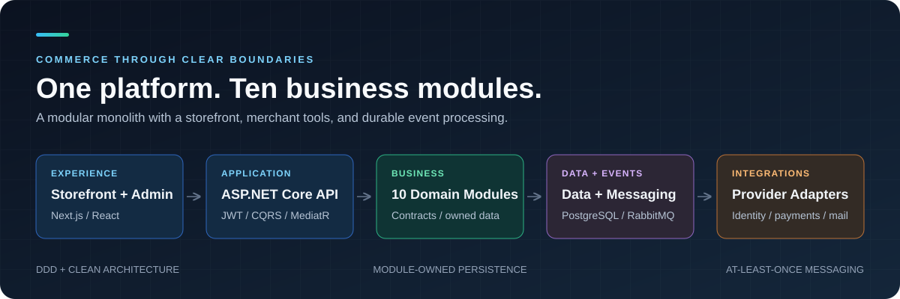
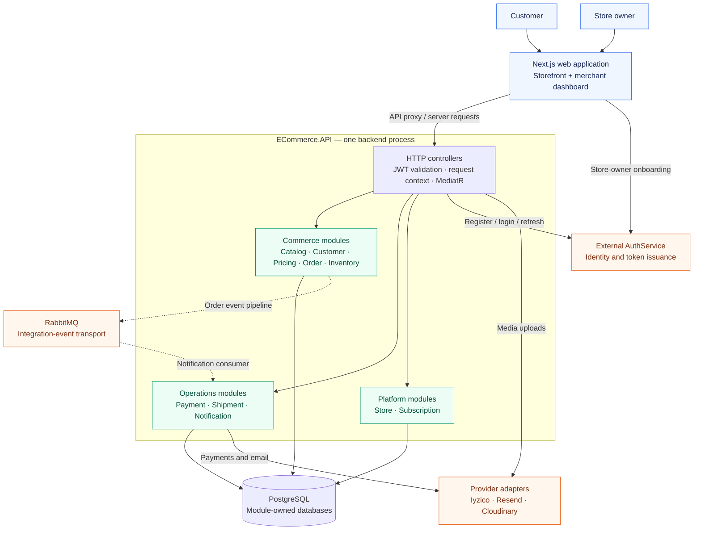
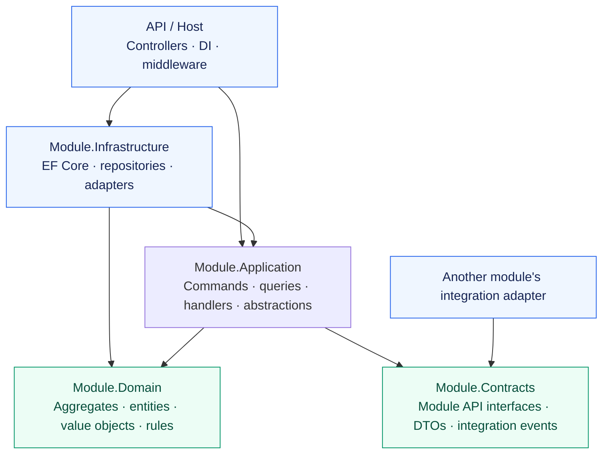
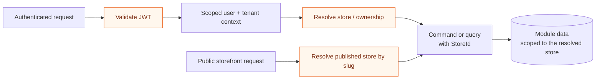
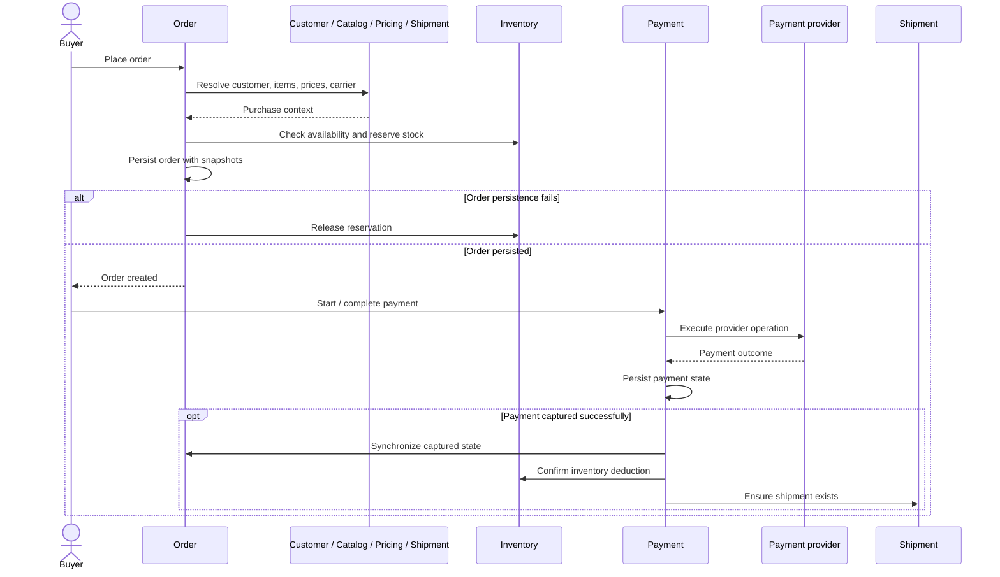
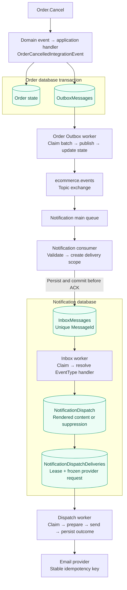
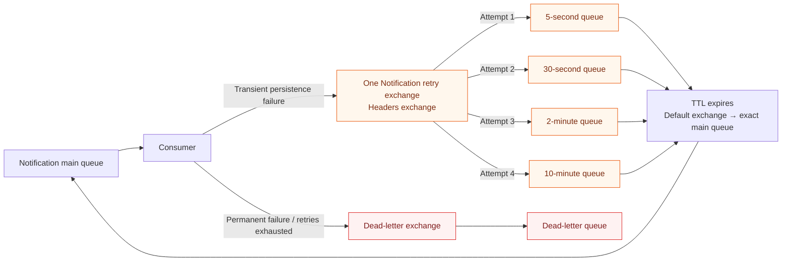
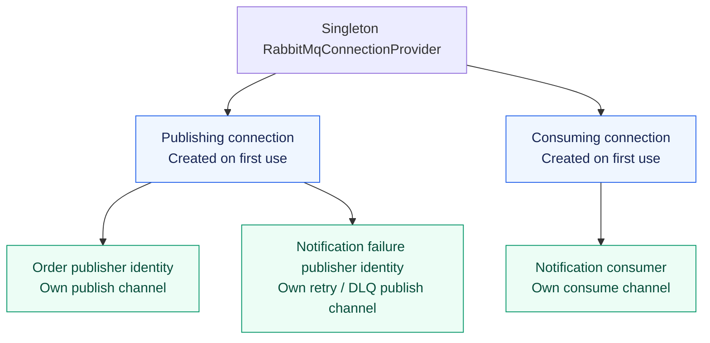
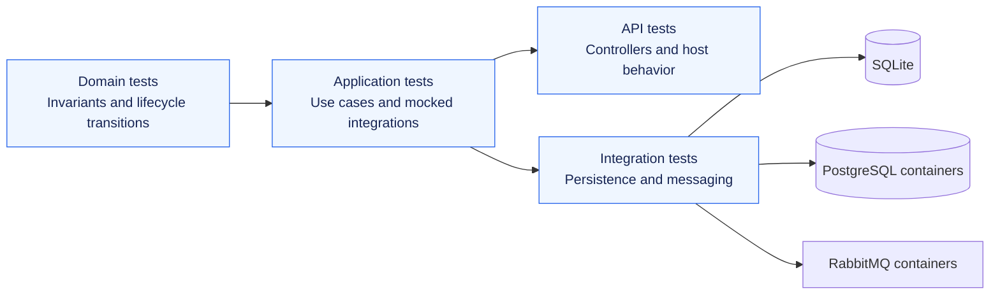
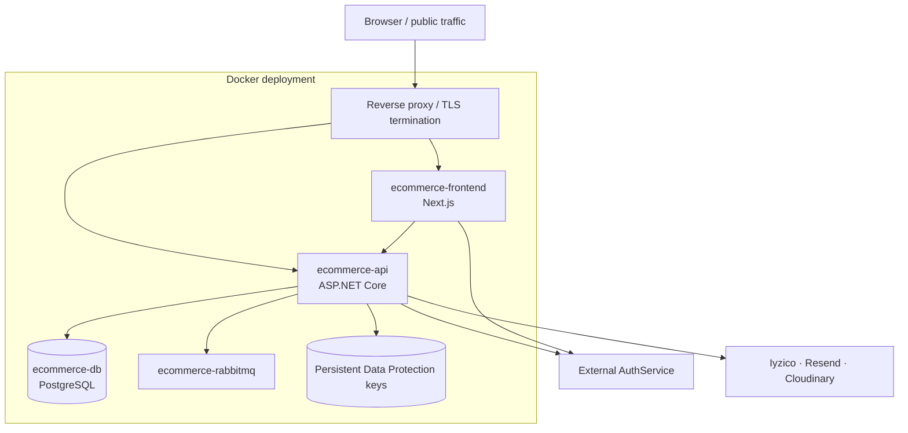

<div align="center">

# Modular SaaS E-Commerce

**A multi-tenant commerce platform built around explicit business boundaries.**

ASP.NET Core backend · Next.js storefront and merchant dashboard · PostgreSQL · RabbitMQ


[Architecture](#architecture) · [Modules](#business-modules) · [Messaging](#reliable-messaging) · [Run locally](#local-development) · [Tests](#testing) · [Documentation](#documentation)



</div>

This repository contains a commerce backend and its web application. Merchants can
configure stores, manage products and stock, process orders, and track payments and
shipments. Customers can browse a store, check out, and manage their account.

The backend runs as one application with ten business modules. Each module owns
its domain model, use cases, persistence, and public contracts. Cross-module
workflows currently combine synchronous module APIs with an implemented
`OrderCancelled` event pipeline using a transactional Outbox and Inbox.

The project is under active development. The diagrams below distinguish existing
capabilities, default runtime wiring, and the next planned work.

## At a glance

| Platform | Architecture | Data ownership | Verification |
| --- | --- | --- | --- |
| Customer storefront + merchant dashboard | 10 business modules in one API host | 10 module DbContexts and separate database configuration | 25 backend test projects |
| Next.js App Router + React | DDD, Clean Architecture, CQRS, MediatR | PostgreSQL; no shared cross-module DbContext | Domain, application, API, persistence, and broker tests |
| Store-scoped commerce | Contracts for cross-module access | Order Outbox + Notification Inbox | PostgreSQL and RabbitMQ Testcontainers |

## Platform overview



`AuthService` is an external dependency; its implementation is maintained outside
this repository. PostgreSQL and RabbitMQ are infrastructure services. The business
modules are deployed together inside `ECommerce.API`.

## Product capabilities

| Customer experience | Merchant operations |
| --- | --- |
| Storefronts addressed by store slug | Store setup, profile, branding, slug, and publication |
| Product, category, brand, and variant browsing | Product variants, attributes, media, and catalog lifecycle |
| Cart and checkout | Price lists, stock adjustments, reservations, and movement history |
| Customer login, registration, and session refresh | Order, payment, and shipment management |
| Addresses, preferences, and consent management | Shipping carriers, packages, and tracking events |
| Order history, payment result, and shipment tracking | Notification templates, dispatch history, and subscription details |

The frontend lives in [`frontend/`](frontend). It uses Next.js 16, React 19,
TypeScript, Tailwind CSS 4, and Radix UI components. Browser API calls pass through
Next.js route handlers, with cookie-based session handling and access-token
forwarding. The cart is currently persisted in browser local storage; a backend
Cart module is a future extension.

## Business modules

| Module | Owns | Implemented examples |
| --- | --- | --- |
| [Store](src/Modules/Store) | Tenant-to-store mapping and storefront identity | Provisioning, slug availability, branding, publication, suspension |
| [Catalog](src/Modules/Catalog) | Products and catalog organization | Simple/variant products, SKU and slug value objects, attributes, categories, brands, media |
| [Customer](src/Modules/Customer) | Commerce customer profiles | Identity synchronization, addresses, preferences, consents, account lifecycle |
| [Pricing](src/Modules/Pricing) | Price lists and price resolution | Product/variant prices, currency, compare-at prices, priorities, default lists |
| [Order](src/Modules/Order) | Order truth and purchase snapshots | Placement, cancellation, totals, payment/fulfillment state, domain events, Outbox |
| [Inventory](src/Modules/Inventory) | Stock availability and reservations | On-hand/reserved stock, reservation release/confirmation, stock movements, reorder thresholds |
| [Payment](src/Modules/Payment) | Commerce payment lifecycle | Checkout, authorization, capture, cancellation, refunds, attempts, callbacks/webhooks |
| [Shipment](src/Modules/Shipment) | Fulfillment and tracking | Carriers, shipment lines, packages, dispatch, delivery, exceptions, tracking history |
| [Notification](src/Modules/Notification) | Transactional communication | Templates, rendering, dispatch/attempt history, Resend integration, Inbox processing, retry/DLQ |
| [Subscription](src/Modules/Subscription) | SaaS plans and tenant subscriptions | Plan features/quotas, provisioning, subscription checkout, payment completion |

Subscription contracts expose feature and quota information. Existing checks
include storefront video access, price-list limits, and shipping-carrier limits.
Feature definitions do not imply that every listed feature already has a user flow.

## Architecture

### Module and layer boundaries

The API host is the composition root. Controllers delegate to application use
cases; aggregates protect business invariants; Infrastructure implements
repositories, queries, persistence, and provider adapters.

The arrows below show code dependencies:



- Domain models keep business behavior independent of EF Core, HTTP, and RabbitMQ.
- Commands and queries use separate handlers; read services provide query-focused projections.
- Each module owns its DbContext, repository implementations, configurations, and migrations.
- Integration adapters call other modules through their Contracts projects.
- CQRS currently separates code responsibilities over module databases; it does not require separate read/write database servers.

### Tenant and store context

Identity and commerce use related but distinct identifiers. JWT claims supply the
authenticated user and tenant context. Store ownership resolves commerce
operations to a `StoreId`, while public storefront routes resolve a store by slug.



Separate databases provide **module isolation**. Tenant/store identifiers and
ownership checks provide **tenant isolation within each module**. This is not a
database-per-tenant deployment model.

### Commerce workflow

Order placement resolves customer/address, catalog, price, and carrier data
through contracts and stores snapshots of the purchase context. Inventory is
reserved before order persistence, with compensation if persistence fails.



These commerce integrations currently use in-process module APIs. They span
independent module transactions; they are not one distributed database transaction.
The event pipeline below is the first implemented path toward broader asynchronous
integration.

## Reliable messaging

### Order cancellation to Notification



**Implemented guarantees and boundaries:**

| Boundary | Behavior |
| --- | --- |
| Order → Outbox | Order changes and the serialized integration event are saved together |
| Outbox → broker | Publisher confirmations, mandatory publishing, timeout, and persisted retry state |
| Broker → Inbox | Validate and persist before ACK; duplicate `MessageId` returns an idempotent result |
| Inbox → dispatch | Dispatch changes and Inbox `Processed` transition commit in one transaction |
| Dispatch → email provider | Explicit delivery queue, stable provider request/idempotency key, persisted attempts and retry scheduling |
| Worker ownership | PostgreSQL `FOR UPDATE SKIP LOCKED`, expiring leases, and ownership-checked updates |
| Delivery semantics | At-least-once delivery; duplicates are expected and handled through idempotency |
| Processing concurrency | Current batches are processed sequentially; claim stores support multiple workers/instances |

### Broker retries and dead letters

Transient failures before Inbox persistence are routed to staged retry queues.
Permanent validation failures and exhausted retries are sent to the dead-letter
queue.



TTL expiry routes the message only to the original consumer queue, avoiding a
second broadcast to other modules. Retry headers preserve the original exchange,
routing key, attempt number, and first failure time.

Broker retry uses fixed configured TTL tiers. Inbox processing retries use
database scheduling with exponential backoff and jitter. These handle different
failure boundaries.

### Connection and channel ownership



Each closed generic publisher identity gets its own singleton publisher and
channel. Publishing is serialized per publisher channel; publishing and consuming
use separate connections. Failure publishing has its own channel rather than
sharing the consumer channel.

### Runtime status

The OrderCancelled pipeline is wired into the API host and enabled in the
checked-in development configuration:

- `AddOrderModule(configuration)` registers Order infrastructure and its Outbox polling service.
- Notification `IntegrationEventConsumer.Enabled`, `InboxProcessor.Enabled`, and `DispatchProcessor.Enabled` are `true` in development. Their option-class defaults remain `false`; production activation is a separate deployment choice.
- Order cancellation uses the event pipeline exclusively; the command handler no longer calls the synchronous notification sender.
- Other commerce notification flows still use their existing direct APIs. Their migration is outside this rollout.
- The Inbox path creates a dispatch and a delivery queue row atomically. The dispatch worker sends outside the database transaction and persists the outcome with attempt history.

Real PostgreSQL, RabbitMQ, and Resend verification covered successful cancellation
delivery, permanent provider rejection, and duplicate event delivery without a
second email. The recipient confirmed receipt. This exercised a domain-created
test order; browser checkout and HTTP cancellation were not part of that run.
The configured sender domain must be verified before normal email delivery;
the live test used a temporary Resend test sender.

See [Notification Messaging Architecture](docs/NotificationMessagingArchitecture.md)
for the detailed delivery, ACK, retry, and processing diagrams.
See [Notification Dispatch Delivery](docs/NotificationDispatchDelivery.md) for
provider request snapshots, retry policy, and the bounded idempotency window.
See [Phase 8 verification](docs/Phase8MessagingVerification.md) for the rollout
checks, test commands, and remaining operational work.

## Technology

| Area | Implementation |
| --- | --- |
| Backend | C#, .NET 10, ASP.NET Core controllers |
| Use cases | MediatR, CQRS handlers, explicit mapping and validation |
| Persistence | EF Core, Npgsql, PostgreSQL |
| Messaging | RabbitMQ .NET client, transactional Outbox/Inbox, hosted services |
| Web | Next.js 16, React 19, TypeScript, Tailwind CSS 4, Radix UI |
| Identity | External AuthService, JWT validation, role-based policies, HTTP-only session cookies |
| Payments | Mock commerce gateway and Iyzico adapter; Iyzico subscription checkout |
| Email and media | Resend / mock email gateway, Cloudinary media storage |
| Operations | Docker Compose, Nginx reverse proxy, Serilog, persistent Data Protection keys |
| Tests | MSTest, Moq, SQLite-backed tests, PostgreSQL/RabbitMQ Testcontainers |

## Repository layout

```text
.
├── src/
│   ├── BuildingBlocks/
│   │   ├── BuildingBlocks.Domain/
│   │   ├── BuildingBlocks.Application/
│   │   ├── BuildingBlocks.Infrastructure/
│   │   ├── BuildingBlocks.Messaging/
│   │   ├── BuildingBlocks.Messaging.RabbitMQ/
│   │   └── tests/
│   ├── Host/
│   │   └── ECommerce.API/              # Main backend composition root
│   └── Modules/
│       ├── Catalog/   Customer/   Inventory/   Notification/   Order/
│       ├── Payment/   Pricing/    Shipment/    Store/          Subscription/
│       └── <Module>/
│           ├── <Module>.Domain/
│           ├── <Module>.Application/
│           ├── <Module>.Infrastructure/
│           ├── <Module>.Contracts/
│           └── tests/                  # Available for most modules
├── Host/ECommerce.API.UnitTests/        # API-level tests
├── frontend/                           # Storefront and merchant application
├── infra/docker/                       # PostgreSQL initialization and Nginx
├── scripts/                            # Development and tunnel helpers
├── docs/                               # Architecture and deployment notes
├── docker-compose.development.yml      # Local RabbitMQ
├── docker-compose.production.yml       # Database, broker, API, web, optional edge
└── ECommerce.slnx
```

## Local development

### Prerequisites

- .NET 10 SDK and the EF Core 10 CLI tool.
- Node.js 22 and npm.
- PostgreSQL 17, with credentials allowed to create the module databases.
- Docker with Linux containers for RabbitMQ and Testcontainers integration tests.
- A running, compatible external AuthService for registration, login, and tenant onboarding.

Commands below use PowerShell and run from the repository root unless stated
otherwise.

### 1. Clone and restore

```powershell
git clone https://github.com/gorkemkayas/modular-saas-ecommerce.git
cd modular-saas-ecommerce
dotnet restore ECommerce.slnx
dotnet dev-certs https --trust
```

If `dotnet ef` is not installed:

```powershell
dotnet tool install --global dotnet-ef --version "10.*"
```

### 2. Start RabbitMQ

```powershell
docker compose -f docker-compose.development.yml up -d
```

The development Compose file starts RabbitMQ only. It exposes AMQP on `5672` and
the management UI at `http://localhost:15672`. Its default local credentials are
`ecommerce` / `ecommerce-dev`.

### 3. Configure databases and backend secrets

The host already has a `UserSecretsId`. Configure all ten module connections; an
example naming convention matching the production template is shown below.

```powershell
$apiProject = "src/Host/ECommerce.API/ECommerce.API.csproj"
$moduleNames = @(
    "Store", "Catalog", "Customer", "Pricing", "Inventory",
    "Notification", "Order", "Payment", "Shipment", "Subscription"
)
$databasePassword = "replace-with-your-local-postgres-password"

foreach ($module in $moduleNames) {
    $databaseName = "ecommerce_$($module.ToLowerInvariant())"
    createdb --host=localhost --port=5432 --username=postgres $databaseName
    dotnet user-secrets set "Modules:$($module):Database:ConnectionString" "Host=localhost;Port=5432;Database=$databaseName;Username=postgres;Password=$databasePassword" --project $apiProject
}

dotnet user-secrets set "Jwt:Secret" "replace-with-the-auth-service-signing-secret-at-least-32-characters" --project $apiProject
dotnet user-secrets set "Jwt:Issuer" "https://your-auth-service.example" --project $apiProject
dotnet user-secrets set "AuthService:BaseUrl" "https://your-auth-service.example" --project $apiProject
dotnet user-secrets set "AuthService:ApiKey" "replace-with-your-auth-service-api-key" --project $apiProject
dotnet user-secrets set "ServiceTokens:ECommerce" "replace-with-your-internal-service-token" --project $apiProject
dotnet user-secrets set "Messaging:RabbitMq:Password" "ecommerce-dev" --project $apiProject
dotnet user-secrets set "Modules:Notification:Email:Provider" "Mock" --project $apiProject
dotnet user-secrets set "Frontend:BaseUrl" "https://localhost:3000" --project $apiProject
```

`createdb` prompts for the PostgreSQL password when required by your local
authentication setup. Skip database creation for databases that already exist.
Keep the same terminal open for the migration step below.

The identity service must issue tokens with the configured issuer/signing secret
and the `tenant-api` audience expected by the API. Configure the provider settings
below only for the flows you want to exercise:

| Flow | Additional configuration |
| --- | --- |
| Real email delivery | `Modules:Notification:Email:Provider=Resend`, API key, sender settings, webhook secret |
| Product/store media uploads | `CloudinaryMediaStorage:CloudName`, `ApiKey`, `ApiSecret` |
| Real commerce payments | `Modules:Payment:Gateway:Provider=Iyzico`, provider credentials/account setup, callback URL |
| Subscription checkout | `Modules:Subscription:Iyzico` credentials, base URL, callback URL |

The commerce payment gateway defaults to `Mock` in development. Subscription
checkout uses the Iyzico subscription adapter and requires its own configuration.

### 4. Apply module migrations

```powershell
foreach ($module in $moduleNames) {
    dotnet ef database update --project "src/Modules/$module/$module.Infrastructure" --startup-project $apiProject --context "$($module)DbContext" -- --environment Development
}
```

Apply migrations explicitly for a fresh installation. Startup contains
module-specific migration/seed behavior for Notification, Subscription, and
development Order setup; it is not a universal migration runner for all modules.

### 5. Start the API

```powershell
dotnet run --project src/Host/ECommerce.API/ECommerce.API.csproj --launch-profile https
```

| Endpoint | Local address |
| --- | --- |
| HTTPS API | `https://localhost:7177` |
| HTTP API | `http://localhost:5241` |
| Scalar API reference | `https://localhost:7177/scalar/v1` |
| OpenAPI document | `https://localhost:7177/openapi/v1.json` |

Scalar and OpenAPI routes are enabled in the Development environment.

### 6. Start the web application

Create `frontend/.env.local`:

```dotenv
NEXT_PUBLIC_API_BASE_URL=https://localhost:7177
NEXT_PUBLIC_DEFAULT_STORE_SLUG=your-published-store-slug
AUTH_SERVICE_BASE_URL=https://your-auth-service.example
AUTH_SERVICE_API_KEY=replace-with-your-auth-service-api-key
AUTH_SERVICE_STORE_OWNER_REGISTER_PATH=/api/v1/tenants/register
```

Then, in another terminal:

```powershell
cd frontend
npm ci
npm run dev
```

The development script uses HTTPS; open `https://localhost:3000` and trust the
development certificate as needed. The Next.js server must also trust the API
certificate for server-side proxy requests.

| Web route | Purpose |
| --- | --- |
| `/` | Platform landing page |
| `/store-register` | Store-owner onboarding |
| `/{storeSlug}` | Published storefront |
| `/{storeSlug}/products` | Store catalog |
| `/{storeSlug}/checkout` | Customer checkout |
| `/{storeSlug}/account` | Customer account |
| `/{storeSlug}/admin` | Store management |

A fresh database does not contain a complete demo store/catalog/customer dataset.
Use onboarding or the API to create the store and its commerce data.

## Testing

Tests are organized by module and layer. Integration suites use SQLite where
appropriate, and real PostgreSQL/RabbitMQ containers for provider-specific
persistence and broker behavior.



Build and run the backend suites from the repository root:

```powershell
dotnet build ECommerce.slnx
dotnet test ECommerce.slnx
```

Docker must be running for the Testcontainers suites. These create isolated test
infrastructure rather than using your development module databases.

<details>
<summary><strong>Run focused messaging and persistence suites</strong></summary>

```powershell
dotnet test src/BuildingBlocks/tests/BuildingBlocks.Messaging.RabbitMQ.IntegrationTests/BuildingBlocks.Messaging.RabbitMQ.IntegrationTests.csproj
dotnet test src/Modules/Order/tests/Order.Infrastructure.IntegrationTests/Order.Infrastructure.IntegrationTests.csproj
dotnet test src/Modules/Notification/tests/Notification.Infrastructure.IntegrationTests/Notification.Infrastructure.IntegrationTests.csproj
```

Covered scenarios include concurrent claims, expired leases, ownership checks,
duplicate delivery, Inbox transactions, handler failures, retry TTL routing,
metadata preservation, and dead-letter delivery.

</details>

For the web production build:

```powershell
npm --prefix frontend run build
```

## Deployment

The production Compose file defines PostgreSQL, RabbitMQ, the API, the frontend,
and an optional Nginx service enabled with the `edge` profile.



Prepare environment values, module schemas, and the external identity service
before starting the complete application stack:

```powershell
Copy-Item .env.production.example .env.production
# Replace placeholders and set provider-specific values in .env.production.
docker compose --env-file .env.production -f docker-compose.production.yml config
docker compose --env-file .env.production -f docker-compose.production.yml up -d --build
```

Use `--profile edge` when you want the bundled Nginx container. Its configuration
provides HTTP routing; HTTPS termination must be supplied by the deployment
environment. PostgreSQL initialization creates the configured databases on a new
data volume; it does not apply every module's EF migrations.

Keep Data Protection keys persistent so stored payment-provider credentials
remain decryptable after restarts. AuthService is not built or deployed by this
Compose file.

Detailed instructions: [Docker guide](docs/DockerProductionGuide.md) and
[deployment runbook](docs/ProductionDeploymentRunbook.md). Some operational notes
predate the RabbitMQ additions; the Compose files and current source define the
active service configuration.

## Development direction

| Area | Current position | Next direction |
| --- | --- | --- |
| Commerce | Store, catalog, customer, pricing, orders, inventory, payments, and shipment workflows | Broader end-to-end validation and operational hardening |
| Web application | Storefront, account, checkout, and merchant routes exist | Continue UX and integration refinement |
| Messaging | OrderCancelled host pipeline enabled in development and verified against real infrastructure | Operational visibility, safe replay, and gradual rollout to other events |
| Notification delivery | Order cancellation uses queued delivery; other workflows retain the direct sender | Verify deployment sender domain and add operational tooling |
| Cross-module reliability | Contracts, explicit orchestration, compensation, and initial event pipeline | Expand event coverage and introduce process managers where workflows need them |
| Product expansion | Ten current business modules | Consider Cart, Promotion, Return, and Review after the core flows mature |

## Documentation

| Document | Contents |
| --- | --- |
| [Notification messaging architecture](docs/NotificationMessagingArchitecture.md) | Detailed consumer, Inbox, retry, ACK, DLQ, and handler diagrams |
| [Notification dispatch delivery](docs/NotificationDispatchDelivery.md) | Dispatch worker, durable delivery queue, provider idempotency, retries, and crash recovery |
| [Phase 8 verification](docs/Phase8MessagingVerification.md) | Host activation, regression coverage, real email verification, and rollout boundaries |
| [Order module design](docs/OrderModuleDesign.md) | Order ownership, snapshots, and lifecycle |
| [Pricing module design](docs/PricingModuleDesign.md) | Price lists and price-resolution design |
| [Notification module design](docs/NotificationModuleDesign.md) | Original module design and links to its asynchronous evolution |
| [Shipment module design](docs/ShipmentModuleDesign.md) | Fulfillment model, packages, and tracking |
| [Docker production guide](docs/DockerProductionGuide.md) | Container setup and reverse proxy |
| [Production deployment runbook](docs/ProductionDeploymentRunbook.md) | Identity integration, environment configuration, and deployment operations |

Design notes record the project's evolution and may describe earlier stages.
Use the current implementation and the runtime status above to distinguish
completed behavior from planned work.
