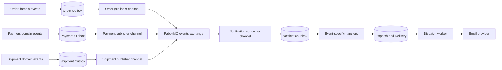

# Commerce Messaging Rollout

The transactional messaging pipeline now covers every existing commerce email
notification trigger. Synchronous calls that return prices, availability, payment
results, or coordinate payment/inventory operations remain synchronous. Shipment
fulfillment updates now reach Order through a separate durable event subscription;
see [Shipment to Order fulfillment](ShipmentOrderFulfillmentMessaging.md).

## Coverage

| Producer | Business outcome | Integration contract | Notification trigger |
| --- | --- | --- | --- |
| Order | First successful payment authorization/capture | `order.order-placed.v1` | OrderPlaced |
| Order | Order cancelled | `order.order-cancelled.v1` | OrderCancelled |
| Payment | Authorized | `payment.status-changed.v1`, Authorized | PaymentAuthorized |
| Payment | Captured | `payment.status-changed.v1`, Captured | PaymentCaptured |
| Payment | Failed | `payment.status-changed.v1`, Failed | PaymentFailed |
| Payment | Refund succeeded | `payment.status-changed.v1`, Refunded | PaymentRefunded |
| Shipment | Created | `shipment.status-changed.v1`, Created | ShipmentCreated |
| Shipment | Shipped | `shipment.status-changed.v1`, Shipped | ShipmentShipped |
| Shipment | Delivered | `shipment.status-changed.v1`, Delivered | ShipmentDelivered |
| Shipment | Delivery exception | `shipment.status-changed.v1`, DeliveryException | ShipmentDeliveryException |

An unpaid order does not emit OrderPlaced. Authorization followed by capture emits
one confirmation in the normal lifecycle; the Notification business key also
prevents another confirmation if a later transition emits the same business outcome.
Each successful partial refund has its own RefundId and produces a separate
PaymentRefund dispatch rather than suppressing subsequent refunds for the payment.



Only modules with a real publishing requirement receive Outbox infrastructure.
Notification consumes the notification contracts. Order additionally consumes
`shipment.fulfillment-changed.v1` in its own queue and Inbox. Other modules receive
consumer infrastructure only when they have a concrete subscription requirement.

## Boundaries and ownership

- Order keeps its established dispatcher, MediatR notification wrappers and Outbox
  writer. Its store and processor delegate to the same engine as the other producers.
  OrderPlaced uses the same path as OrderCancelled.
- Order, Payment and Shipment use a shared PostgreSQL Outbox implementation in
  `BuildingBlocks.Infrastructure.Messaging.Outbox`, with their own DbContexts,
  databases, publisher identities, worker instances, and typed options.
- Domain aggregates only raise domain events. Infrastructure maps Payment and
  Shipment events to contracts before the local SaveChanges transaction commits.
- Payment and Shipment capture customer identity/contact from the Order context
  already required when they are created. Their SaveChanges event mapping uses
  local snapshots only: it never reads another module, publishes, or sends email.
  A failed save retains events and reuses already-staged Outbox entries on retry
  in the same context.
- Historical producer rows may lack contact snapshots. Notification resolves these
  legacy events through an Application abstraction backed by the public Order API.
  Failure schedules an Inbox retry; it cannot block the original payment/shipment
  commit. Complete event snapshots require no Order lookup. Tenant/order/customer
  mismatches are rejected rather than selecting another recipient.
- Local transactions cover each module's business state and Outbox together.
  This does not turn the existing cross-database coordination or payment-provider
  interaction into a distributed transaction or saga.
- The generic Outbox worker uses short, atomic `SKIP LOCKED` claims, checks current
  ownership before publishing, renews valid leases, and applies bounded retries
  with exponential backoff and jitter. Typed identities isolate publisher channels.
- Notification persists the broker delivery before ACK, then routes Inbox records
  to handlers by their contract EventType. Unknown kinds or invalid payloads fail
  explicitly instead of guessing a notification type.
- Delivery remains at-least-once. Independent workers do not promise global event
  ordering across modules; business-key and Inbox deduplication prevent repeated
  notification work for the same operation.
- `QueuedNotificationSender` renders/enqueues inside the Inbox transaction; it
  never calls SaveChanges, commits, or invokes the email provider. Existing
  `NotificationModuleApi` request mapping is reused with this queued sender.

The producer notification adapters were removed. No commerce command handler
calls Notification's direct sending API after committing business state. The
Notification API and synchronous sender remain as compatibility components;
they are not invoked by these commerce flows.

## Preserved synchronous interactions

| Area | Reason for keeping the current call |
| --- | --- |
| Catalog and Pricing lookups | Checkout needs a validated sellable item and price immediately |
| Customer/address/tenant context | Commands need ownership and address validation before accepting work |
| Inventory reservation and compensation | Existing checkout/payment coordination needs the operation result |
| Payment gateway authorization/capture/refund | The command or callback needs the provider result |
| Payment-to-Order status synchronization | Existing business coordination remains in place |
| Payment-to-Shipment creation | Existing captured-order workflow remains in place |
| Store, Subscription, tenant/auth, media and storefront calls | No fire-and-forget notification requirement was found to replace here |

The retained synchronous decisions above do not use eventual consistency. Shipment
fulfillment propagation is asynchronous; its source owns active-shipment checks.
This does not claim to solve all pre-existing partial-failure windows
between independently committed modules.

## Refund safety

Each new refund stores its stable operation key, with a unique filtered database
index on `(PaymentId, IdempotencyKey)`. Replaying the same key returns the existing
refund without a second provider call, refund identity, event, or email. Reusing
the key for another amount/reason is rejected before contacting the provider.
Different partial refund operations retain separate keys and notifications.

Refund commands and refund callbacks acquire the same per-payment PostgreSQL
advisory lock before loading the mutable aggregate. This works across API
instances and returns HTTP 409 when the payment already has an active refund
operation. The lock has a dedicated nonpooled connection, released on disposal;
no database transaction stays open during the provider request. Independent
payments can proceed concurrently. This connection uses the Payment database
and must reach the same PostgreSQL session for the operation's duration.

Successful local Payment/Refund/Outbox changes are saved before synchronous Order
coordination. Only a fully refunded payment marks the Order refunded; a partial
refund does not. If Order coordination fails after the local save, replaying the
same command retries coordination without refunding again. A rejected refund
records a failed **attempt** while preserving Captured/PartiallyRefunded; it does
not emit PaymentFailed or send a misleading payment-failure notification.

Refund callbacks require a stable operation identifier. The parser prefers an
explicit `idempotencyKey`, then `refundId`, `token`, or `eventId`; a payment reference
alone is not a refund identity. Provider adapters must correlate a callback with
the command's operation key when both describe the same refund. A reused payment
reference or amount alone is insufficient to infer that relationship. Historical
keyless refunds are replayed only when the old attempt history identifies exactly
one result; ambiguous history requires reconciliation.

These safeguards do not make the remote provider and local database one atomic
transaction. Provider acceptance followed by process/database failure still needs
provider-side idempotency or reconciliation before repeating an uncertain refund.
The system does not claim exactly-once charging/refunding across that boundary.

## Durable email content

Order items now persist the optional product image URL from the sellable-item
snapshot. OrderPlaced carries item names, quantities, prices, image URLs, and
totals without needing a live catalog lookup to reconstruct the email later.
Existing order items keep a null image URL; no historical backfill is performed.

The delivery queue's optional JSON `Content` stores rich email details, action
links, order lines, and totals. The Dispatch worker uses this while preparing its
immutable provider request. Once prepared, retries keep using the same full
payload, sender, provider, and idempotency key. Old delivery rows without Content
remain supported.

## Configuration and migration

Apply all four modules' migrations before running the updated workers:

```powershell
$api = "src/Host/ECommerce.API/ECommerce.API.csproj"

dotnet ef database update --project src/Modules/Order/Order.Infrastructure/Order.Infrastructure.csproj --startup-project $api --context OrderDbContext -- --environment Development
dotnet ef database update --project src/Modules/Payment/Payment.Infrastructure/Payment.Infrastructure.csproj --startup-project $api --context PaymentDbContext -- --environment Development
dotnet ef database update --project src/Modules/Shipment/Shipment.Infrastructure/Shipment.Infrastructure.csproj --startup-project $api --context ShipmentDbContext -- --environment Development
dotnet ef database update --project src/Modules/Notification/Notification.Infrastructure/Notification.Infrastructure.csproj --startup-project $api --context NotificationDbContext -- --environment Development
```

The additive migrations are AddOrderItemImageSnapshot, Payment/Shipment
AddTransactionalOutbox, AddDeliveryContentSnapshot,
Payment AddCustomerContactAndRefundIdempotency, and Shipment AddShipmentCustomerContact.
Contact fields and historical refund keys remain nullable; there is no unsafe
backfill or rewrite of already-applied migrations. These migrations do not enqueue
old business records or resend previous notifications.

The initial Shipment migration was missing discovery metadata; its original ID
and context attribute are now restored so clean databases receive the schema.
If an older installation manually created Shipment tables without recording this
migration, inspect and reconcile its schema/history before upgrading. Do not
delete tables or mark migrations applied without comparing the actual schema.

Payment and Shipment options bind from `Modules:Payment:Outbox` and
`Modules:Shipment:Outbox`. Defaults are batch 20, poll 5 seconds, lease 2 minutes,
10 attempts, retry 5 seconds to 5 minutes, and jitter factor 0.2. Publisher timeout
settings still come from `Messaging:RabbitMq`.

Development keeps the three Notification workers enabled. Production Compose
exposes `NOTIFICATION_CONSUMER_ENABLED`, `NOTIFICATION_INBOX_ENABLED`, and
`NOTIFICATION_DISPATCH_ENABLED`, defaulting to true. Complete migrations, queue
provisioning, credentials, and sender-domain verification before deployment.
Disabling the consumer while publishers run can exhaust unroutable-message
retries on a fresh broker without pre-provisioned queues.

## Verification and limits

Automated tests use isolated PostgreSQL/RabbitMQ containers and a recording email
gateway; they do not send live emails or invoke real payment gateways. They cover:

- All nine newly migrated outcomes through Inbox, durable Dispatch, and gateway.
- Routing all new contracts through real RabbitMQ, including duplicate delivery.
- One confirmation across authorization/capture and distinct partial refunds.
- Producer state/Outbox atomicity, rollback, save failure/retry, and schema snapshots.
- Concurrent claims, stale-owner protection, publish success, and retry exhaustion.
- Shared Order/Payment/Shipment lease renewal, attempt budgets, and jitter bounds.
- Refund replay after reload, operation-key uniqueness, cross-session refund locking,
  failed-attempt semantics, and save-before-Order coordination.
- Complete contact snapshots without Order reads, plus legacy recipient read failure
  and recovery confined to the Notification Inbox retry boundary.
- Existing synchronous command coordination, cancellation, consumer, retry, and
  immutable-delivery-request regressions.

The October 28, 2026 verification run passed 187 tests across 13 selected suites:
Order 35, Payment 29, Shipment 9, Notification 101, RabbitMQ 11, and Host Outbox
registration 2. The full solution built with zero errors; pre-existing dependency
and analyzer warnings remain. This is targeted regression coverage rather than a
claim that every repository test was executed.

The four modules' migrations were also applied to the local development databases.
That does not apply them to production; deployments must run their own migration
step before starting the updated application.

The earlier live OrderCancelled-to-email smoke test is recorded in
[Phase 8 verification](Phase8MessagingVerification.md). New outcomes are not
claimed to have been tested through browser checkout or against a real email
provider. Phase 9 observability remains deferred until this rollout is reviewed.
