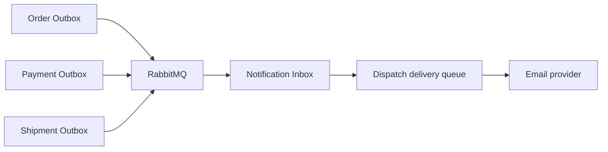
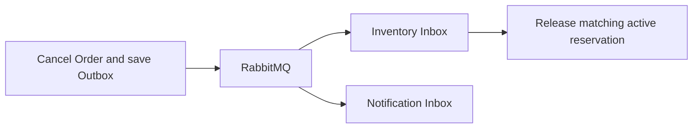
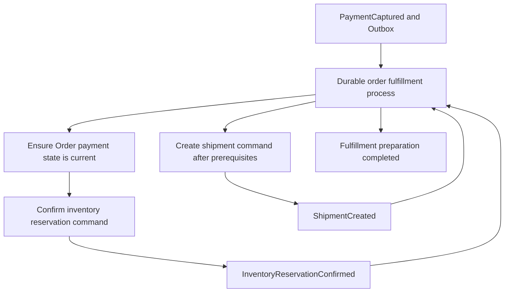
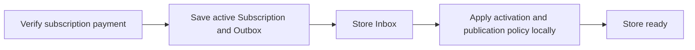

# Module Communication Assessment

Assessment date: 2026-10-29. This is a source-based design review of all ten modules and the Host workflows that connect them. It proposes no automatic migration and changes no runtime behavior. Proposed message names below are illustrative unless explicitly marked as existing.

The existing rollout covers ten commerce notification outcomes. It does not yet provide durable coordination for every cross-module business operation. Existing synchronous calls are not all mandatory synchronous boundaries, and replacing them requires more than publishing their current arguments.

## Decision criteria

| Decision | Meaning |
| --- | --- |
| Keep synchronous | The current command/query needs an authoritative answer before accepting or returning its result. |
| Local transaction | State changes owned by one module should commit locally; a broker is not needed merely to execute a local command. |
| Event follow-up candidate | A committed fact can trigger independently retryable work elsewhere; a delay is acceptable and visible in the product model. |
| Durable workflow candidate | Several committed steps have prerequisites, timeouts, or business failure decisions; use a process manager/saga or equivalent durable coordination. |
| Conditional projection/notification | Useful only when a real consumer, product requirement, or measured read bottleneck exists. |

An HTTP request can synchronously accept a command while its cross-module consequences run asynchronously. The response must describe the accepted local result, rather than imply that all consequences completed. Separate databases remain separate transaction boundaries even inside one process.

## Current topology

- Producers: Order, Payment, Shipment, each with its own Outbox and publisher identity/channel.
- Consumer: Notification, with Inbox processing and a separate durable Dispatch delivery queue.
- Common code: Outbox persistence schema for new producers, event staging base context, PostgreSQL claim/store, processor, options and worker registration. Order retains its dispatcher/writer and delegates publication to the common engine.
- Other modules currently have no broker consumers for the business follow-ups assessed here.

## 1. Catalog

Evidence: [publish product](../src/Modules/Catalog/Catalog.Application/Products/Commands/PublishProduct/PublishProductCommandHandler.cs), [subscription guards](../src/Modules/Catalog/Catalog.Application/Products/CatalogSubscriptionGuard.cs), [storefront price reads](../src/Modules/Catalog/Catalog.Infrastructure/ReadServices/StorefrontCatalogReadService.cs), [archive product](../src/Modules/Catalog/Catalog.Application/Products/Commands/ArchiveProduct/ArchiveProductCommandHandler.cs).

| Existing operation | Recommendation | Reason / conditions |
| --- | --- | --- |
| Product/category/media creation and variant-feature admission | Keep synchronous guards | Quota/feature answers determine whether the command may be accepted. |
| PublishProduct -> Pricing coverage check | Keep synchronous for the current publishing contract | Publishing currently requires valid prices. An asynchronous alternative requires a pending-publication state and a changed API/UI contract. |
| Category/brand/attribute existence and product child changes | Local transaction | These are local aggregate/validation operations. |
| Storefront -> Pricing resolution | Keep synchronous initially | The response needs a price. Consider batching before building a projection solely to fix repeated per-product/per-variant lookups. |
| Product description/name/media or variant changes -> search/read model | Conditional event projection | A real search/catalog projection can consume product snapshots and lifecycle facts. No such independent consumer was identified in the reviewed module topology. |
| Product name/SKU snapshots in Inventory | Conditional event projection | Inventory currently copies descriptive Catalog values at creation. If these must stay current, add an explicit update contract and a local domain method; do not silently rewrite historical Order lines. |
| Product archive/unpublish -> other systems | Conditional lifecycle event | Useful for an actual listing/search consumer. Archived products do not imply that owned stock or historical prices should be deleted. |

Do not automatically publish a product when a price is created or create real stock from ProductCreated. Those are business decisions. Initial stock quantity is not inferable from Catalog. A zero-stock inventory draft could be automated only if that becomes an explicit requirement.

## 2. Pricing

Evidence: [price creation validation](../src/Modules/Pricing/Pricing.Application/PriceLists/Commands/SetProductPrice/SetProductPriceCommandHandler.cs), [variant validation](../src/Modules/Pricing/Pricing.Application/PriceLists/Commands/SetVariantPrice/SetVariantPriceCommandHandler.cs), [price-list quota](../src/Modules/Pricing/Pricing.Application/PriceLists/Commands/CreatePriceList/CreatePriceListCommandHandler.cs), [resolution](../src/Modules/Pricing/Pricing.Infrastructure/ReadServices/PriceResolutionReadService.cs).

- Keep Catalog target/variant validation, default-list constraints, quota checks, money/currency validation and local price changes in the accepting transaction flow.
- Keep authoritative checkout price resolution synchronous under the current checkout contract. Store the accepted price as an Order snapshot.
- A storefront price projection is a conditional optimization: price entry changes, entry activation/removal, default-list selection, list activation/archive and priority changes can all affect the effective price. Listening only to a SetProductPrice-style event is incomplete.
- A projection needs tenant/product/variant/currency keys, revisions and a way to rebuild current effective prices. Its display price can lag; checkout must revalidate under an explicit price-acceptance policy.
- Price changes should not retroactively rewrite existing Order totals or send customer mail unless a separate price-watch requirement exists.

## 3. Inventory

Evidence: [Inventory module API](../src/Modules/Inventory/Inventory.Application/Contracts/InventoryModuleApi.cs), [item creation and Catalog lookup](../src/Modules/Inventory/Inventory.Application/InventoryItems/Commands/CreateInventoryItem/CreateInventoryItemCommandHandler.cs), [reservation and stock rules](../src/Modules/Inventory/Inventory.Domain/Entities/InventoryItem.cs), [reservation state machine](../src/Modules/Inventory/Inventory.Domain/Entities/InventoryReservation.cs), [concurrency token](../src/Modules/Inventory/Inventory.Infrastructure/Persistence/Configurations/InventoryItemConfiguration.cs).

| Existing operation | Recommendation | Reason / conditions |
| --- | --- | --- |
| Checkout availability check and ReserveAsync | Keep reservation result synchronous for the current UX | Availability reads alone do not reserve stock. The actual reservation must enforce availability under concurrent requests. Inventory already has a Version concurrency token. |
| Manual AddStock/AdjustStock/threshold changes | Local transaction | The admin is changing Inventory-owned state. Publish secondary facts only for real consumers. |
| CreateInventoryItem -> Catalog lookup | Keep synchronous | The command currently requires a valid active target and returns the created inventory identity. |
| Order cancellation -> release reservation | Strong event follow-up candidate | An Order cancellation can commit with its Outbox fact; Inventory can independently persist receipt and release with retries. Briefly held stock reduces availability rather than making it oversellable. |
| Payment capture -> confirm reservation/deduct stock | Durable workflow candidate | It must be coordinated with payment state, cancellation and shipment creation. |
| Low-stock threshold crossing -> merchant notification | Conditional product feature | IsLowStock exists, but a low-stock notification trigger/recipient policy is not currently implemented. Emit a threshold-crossing fact rather than mail on every decrement. |
| Available stock -> storefront listing projection | Conditional projection | Informational display may lag; checkout reservation must still use Inventory authority. |

The current OrderCancelled contract lacks ReservationReference. A new Inventory consumer needs an evolved contract/dedicated release message or an intentional lookup strategy for legacy messages. The consumer must not release a Confirmed reservation, must tolerate an already Released reservation, and must validate tenant/order ownership.

Cancellation and capture must also have an explicit coordination policy. Order currently allows cancellation of Authorized orders but disallows Captured/Refunded ones. Do not treat a delayed Order payment-status copy as proof that no capture occurred. A focused first migration can restrict itself to cancellations whose payment lifecycle is already safely resolved; authorization void/capture races belong to the broader workflow. A one-time status query alone does not make concurrent cancellation and capture atomic.

The current reservation entity has no expiry timestamp. A future expiry policy requires a scheduled state transition coordinated with payments; broker retry TTL is not an inventory reservation expiry policy.

## 4. Order

Evidence: [place order](../src/Modules/Order/Order.Application/Orders/Commands/PlaceOrder/PlaceOrderCommandHandler.cs), [cancel order](../src/Modules/Order/Order.Application/Orders/Commands/CancelOrder/CancelOrderCommandHandler.cs), [Order aggregate](../src/Modules/Order/Order.Domain/Entities/Order.cs), [cancelled contract](../src/Modules/Order/Order.Contracts/IntegrationEvents/OrderCancelledIntegrationEvent.cs).

- Keep customer/address ownership, active shipping-carrier selection, sellable item lookup, checkout price resolution and reservation acceptance synchronous for the current command contract.
- OrderPlaced/OrderCancelled notifications already use Outbox -> Notification. OrderPlaced is raised on the first successful authorization/capture transition, not merely on creation of an unpaid Order.
- CancelOrder currently saves the cancelled Order and then calls Inventory.ReleaseReservationAsync. A crash between these steps leaves a cancelled Order with reserved stock. A durable cancellation follow-up is a strong candidate and can reuse an evolved cancellation fact.
- PlaceOrder reserves Inventory before saving Order, then tries to release on save failure. That compensation is currently an in-request attempt. A durable checkout/provisioning workflow could recover a failed release or process crash, but requires pending states and cannot be achieved by adding a post-save notification event alone.
- Order can consume Payment and Shipment lifecycle facts instead of being synchronously updated by those producers. Its copied status can then lag; controllers and customers must see accurate intermediate states.
- Payment status is also used for cancellation admission, not just display. An eventually consistent copy must not silently become the only authority for a money-sensitive transition. Define the cancellation/capture coordination before replacing that dependency; the current synchronous chain is not a cross-database atomic transaction either.
- Existing MarkPaymentAuthorized/MarkPaymentCaptured and MarkShipped/MarkDelivered are not a complete stale-event policy. For example, a late Authorized or Shipped update must not downgrade Captured or Delivered state. Add producer revisions and/or explicit transition guards, plus active-shipment identity checks.

## 5. Payment

Evidence: [capture](../src/Modules/Payment/Payment.Application/Payments/Commands/CapturePayment/CapturePaymentCommandHandler.cs), [authorization](../src/Modules/Payment/Payment.Application/Payments/Commands/AuthorizePayment/AuthorizePaymentCommandHandler.cs), [checkout completion](../src/Modules/Payment/Payment.Application/Payments/Commands/CompletePaymentCheckout/CompletePaymentCheckoutCommandHandler.cs), [webhook](../src/Modules/Payment/Payment.Application/Payments/Commands/ProcessPaymentWebhook/ProcessPaymentWebhookCommandHandler.cs), [cancel payment](../src/Modules/Payment/Payment.Application/Payments/Commands/CancelPayment/CancelPaymentCommandHandler.cs), [refund](../src/Modules/Payment/Payment.Application/Payments/Commands/RefundPayment/RefundPaymentCommandHandler.cs), [current contract](../src/Modules/Payment/Payment.Contracts/IntegrationEvents/PaymentStatusChangedIntegrationEvent.cs).

Keep provider requests that return checkout/action URLs or immediate authorize/capture/refund results synchronous under the current API contract. Retain signature validation, payment ownership, provider account selection, local state validation and refund concurrency/idempotency protections. Awaiting an external provider is not a reason to send the request through RabbitMQ.

Payment -> Order status changes are event candidates, with explicit stale/duplicate/final-state rules. Payment -> Inventory confirmation -> Shipment creation should be considered one durable fulfillment workflow. Several entry points currently repeat this sequence: authorization returning Captured, explicit capture, checkout completion and provider webhooks. They should converge on one stable business operation in an eventual redesign.

Current payment facts cover Authorized, Captured, Failed and Refunded. Cancelled is absent. Payment cancellation currently updates Order/releases Inventory before saving local Payment state; a durable design should commit the local result plus the follow-up message before downstream effects.

Do not equate a failed payment attempt with a permanently cancelled Order. A customer may retry payment. Do not release Inventory on every PaymentFailed event without a defined order/payment lifecycle. A refund also does not automatically imply that goods have returned to the warehouse.

A fulfillment message needs reservation identity and the required immutable order/shipping snapshot, or an explicit consumer lookup contract. The current notification-oriented Payment event lacks ReservationReference and complete shipment data. Monetary success + Outbox is atomic only locally; uncertain provider acceptance still requires provider idempotency/reconciliation.

## 6. Shipment

Evidence: [creation](../src/Modules/Shipment/Shipment.Application/Shipments/Commands/CreateShipment/CreateShipmentCommandHandler.cs), [ensure creation](../src/Modules/Shipment/Shipment.Application/Shipments/Commands/EnsureShipmentCreatedForCapturedOrder/EnsureShipmentCreatedForCapturedOrderCommandHandler.cs), [Order synchronization adapter](../src/Modules/Shipment/Shipment.Infrastructure/Integrations/Order/OrderShipmentSyncService.cs), [cancellation](../src/Modules/Shipment/Shipment.Application/Shipments/Commands/CancelShipment/CancelShipmentCommandHandler.cs), [contract](../src/Modules/Shipment/Shipment.Contracts/IntegrationEvents/ShipmentStatusChangedIntegrationEvent.cs).

- Keep carrier setup, quota checks, package operations and manual status commands as local accepting operations. Keep current shipping-carrier lookups synchronous where Order needs the selected carrier now.
- Created/Shipped/Delivered/DeliveryException notification facts already exist. Order can independently consume the appropriate facts and update its fulfillment view. This removes the post-Shipment-save dependency on Order availability.
- Include cancellation: CancelShipment currently calls Order synchronously, but Cancelled is not one of the published Shipment kinds. Add an explicit lifecycle contract if that path migrates. ReadyForDispatch/tracking events need publication only if a consumer needs those facts.
- Add version/transition protection before consuming asynchronous updates. The current transport does not promise aggregate ordering. A late event for an old cancelled shipment must not overwrite a replacement shipment's status.
- Shipment creation after payment must wait for the business prerequisites. Under a stock-confirmation requirement, do not let independent consumers race to create Shipment directly from PaymentCaptured.
- Existing EnsureShipmentCreatedForCapturedOrder helps suppress duplicates. An async rollout must also validate database uniqueness/concurrent creation, and adapt its current requirement to read an already-Captured Order when the Order status itself becomes eventually consistent.

## 7. Store

Evidence: [provisioning](../src/Modules/Store/Store.Application/Stores/Commands/ProvisionStoreForTenant/ProvisionStoreForTenantCommandHandler.cs), [profile feature check](../src/Modules/Store/Store.Application/Stores/Commands/UpdateStoreProfile/UpdateStoreProfileCommandHandler.cs), [pending-store cleanup](../src/Modules/Store/Store.Application/Stores/Commands/DeletePendingStore/DeletePendingStoreCommandHandler.cs), [branding API](../src/Modules/Store/Store.Infrastructure/Integrations/StoreModuleApi.cs), [Host provisioning](../src/Host/ECommerce.API/Controllers/Store/Admin/AdminStoresController.cs), [checkout callback](../src/Host/ECommerce.API/Controllers/Subscription/SubscriptionCheckoutController.cs).

- Keep slug uniqueness, local store updates, activation/publication preconditions and video-feature admission synchronous/local under the current API contract.
- Subscription payment completion -> Store activation/publication is a strong event follow-up candidate. Subscription should persist Activation plus its Outbox fact. Store can apply its activation/publication policy in one local transaction and acknowledge after durable receipt.
- Failure cleanup is a separate business action. It must reference the relevant onboarding/payment attempt and only affect the matching PendingPayment store. Do not delete an active or newly re-provisioned store because an older failure arrives late. The current DeletePendingStore handler already guards PendingPayment.
- The Host currently provisions Store and then Subscription as separate commits. Reliable async provisioning is possible, but the client must be able to observe Provisioning/PendingPayment/Ready or failure; admission should not claim that every step completed merely because a message was queued.
- Store branding changes -> Notification branding projection is a conditional dependency-reduction improvement. Today Notification reads Store branding before preparing its immutable provider request; no change is required just to use events.
- Store publish/unpublish/suspend/slug facts could update a real directory/cache. Authoritative access/suspension checks must not depend solely on a stale projection. No such cache was identified as an existing requirement.

Identity detail: existing commerce StoreId arguments generally carry the tenant GUID; the Store aggregate also has a separate Id. New contracts must explicitly distinguish TenantId from Store aggregate Id. A branding projection keyed by the wrong identifier will not serve existing Notification callers correctly.

## 8. Subscription

Evidence: [payment completion](../src/Modules/Subscription/Subscription.Application/Commands/CompleteSubscriptionPayment/CompleteSubscriptionPaymentCommandHandler.cs), [checkout initialization](../src/Modules/Subscription/Subscription.Application/Commands/InitiateSubscriptionCheckout/InitiateSubscriptionCheckoutCommandHandler.cs), [public API](../src/Modules/Subscription/Subscription.Application/Contracts/SubscriptionModuleApi.cs), [subscription state](../src/Modules/Subscription/Subscription.Domain/Entities/TenantSubscription.cs).

- Keep plan selection, immediate feature/quota answers, checkout URL creation and payment verification synchronous for the current consumers.
- SubscriptionActivated -> Store is a concrete candidate, not a hypothetical analytics integration. Today the Host callback completes Subscription, then activates and publishes Store; a crash can split those results.
- A single durable Store follow-up may be sufficient; a saga framework is not mandatory just to apply two local Store changes. A broader external tenant + Store + Subscription onboarding workflow requires explicit progress/recovery decisions.
- Subscription activation/payment-failure notifications are conditional new features: no corresponding NotificationTrigger is currently present. Identify the merchant recipient and template instead of reusing commerce Payment contracts.
- Future PlanChanged/Suspended/Cancelled facts can invalidate real entitlement caches or drive defined Store policies. A delayed cache must not silently decide strict access revocation or quota admission. Resource-created events are appropriate for reporting usage, not as the sole strict quota counter.
- CurrentPeriodEndUtc does not emit an event when time passes. If expiration behavior is added, implement a scheduled durable transition and define its policy before proposing SubscriptionExpired consumers.

Separate correctness observations: HasFeatureAsync/GetQuotaAsync currently read plan features/quotas without themselves enforcing Active status/period validity. Count-then-create quota guards also need a concurrency policy for hard limits. These concerns should be reviewed before using asynchronous entitlement projections; changing transport does not solve them.

## 9. Customer

Evidence: [identity synchronization](../src/Modules/Customer/Customer.Application/Customers/Commands/SyncCustomerFromIdentity/SyncCustomerFromIdentityCommandHandler.cs), [profile update](../src/Modules/Customer/Customer.Application/Customers/Commands/UpdateMyProfile/UpdateMyProfileCommandHandler.cs), [consent](../src/Modules/Customer/Customer.Application/Customers/Commands/UpsertConsent/UpsertConsentCommandHandler.cs), [public read API](../src/Modules/Customer/Customer.Application/Contracts/CustomerModuleApi.cs), [Host authentication flow](../src/Host/ECommerce.API/Controllers/Customer/AuthController.cs).

- Keep address/profile commands, address ownership validation and the authoritative checkout customer lookup synchronous/local for the current contract.
- Authentication/token issuance requires an immediate result. Do not move passwords or token acquisition onto the application event bus.
- The Host synchronizes Customer after successful external registration and login. A source-owned UserRegistered/ProfileChanged outbox stream from AuthService could maintain this local projection. This requires the external service's contract, reliable publication and a strategy for a newly authenticated user whose local Customer is not ready. Current synchronous upsert/read-through can remain during migration.
- A transactional welcome message is a conditional feature. Do not emit a welcome event on every login-driven SyncCustomer update; separate first creation from later synchronization.
- Customer profile/consent changes can feed actual CRM or marketing consumers. No such consumer was identified. Old Order/payment/shipping snapshots should not be silently rewritten when a customer's name/address changes.
- Blocking/consent revocation are authority-sensitive decisions. Any asynchronous secondary copies require a defined lag policy; they cannot substitute for authoritative checks when immediate revocation is required.

The external AuthService repository was not inspected. Suggestions concerning its producer side are conditional, not claims about what it currently implements.

## 10. Notification

Evidence: [Inbox event reader](../src/Modules/Notification/Notification.Infrastructure/Messaging/Inbox/NotificationInboxEventReader.cs), [queued sender](../src/Modules/Notification/Notification.Infrastructure/Messaging/Inbox/QueuedNotificationSender.cs), [provider webhook handler](../src/Modules/Notification/Notification.Application/Notifications/Commands/ProcessResendWebhook/ProcessResendWebhookCommandHandler.cs), [dispatch worker](../src/Modules/Notification/Notification.Infrastructure/Messaging/Dispatch/NotificationDispatchProcessor.cs), [feedback submission](../src/Modules/Notification/Notification.Application/Feedbacks/Commands/SubmitContactFeedback/SubmitContactFeedbackCommandHandler.cs).

- Keep the existing commerce event -> Inbox -> Dispatch delivery pipeline. Local template administration does not need broker round trips.
- Provider webhook ingestion is a concrete durable-processing candidate. Today the handler looks up Dispatch by provider message id and ignores the event when none exists. A provider webhook can race with persistence of the successful send result. Verify the webhook, durably store receipt, return success only after commit, then apply/retry correlation in a worker with bounded retry and stale/duplicate protection.
- This is an internal durable inbox use case; RabbitMQ is not mandatory solely to move work within Notification. Preserve provider event identity, event time and receive time, and do not let older events overwrite newer provider state.
- SubmitContactFeedback currently commits a local row only. If merchant/support mail or a receipt is required, enqueue durable delivery in the same module transaction. A Notification -> RabbitMQ -> Notification loop adds no value unless an independent consumer needs a ContactFeedbackSubmitted fact. Do not send twice from both a direct queue and an event consumer.
- Branding projection is conditional; the current public Store API lookup is defensible. Existing prepared email payloads remain immutable on retry.
- Delivery/bounce facts should be published only for an actual downstream consumer. Keep the commerce Order/Payment result independent from email delivery success.
- Legacy direct NotificationSender/INotificationModuleApi registrations remain; reviewed commerce producers no longer call them. Decide whether to retire or route them through durable delivery before introducing new callers.

## Cross-module workflow proposals

### Cancellation follow-up

Inventory and Notification need separate queues/deduplication scopes. Carry reservation identity and cancellation correlation; validate the current reservation state. Order cancellation may return before stock availability is restored. Recovery must also consider historical cancelled orders whose release previously failed.

### Paid-order fulfillment

Track the stable business operation, completed steps and deadlines. Use idempotent steps and explicit retry/reconciliation/compensation decisions. Temporary Inventory failure is not automatically a refund. A permanent reservation conflict needs a business decision. Refunding money does not itself restock physical goods. PaymentCaptured is separate from FulfillmentPrepared; the UI must distinguish them.

### Subscription activation

The callback page can show payment success plus store setup pending and poll a status endpoint. Do not promise StoreReady on receipt of SubscriptionActivated. Late events must not reactivate an administratively suspended/archived store without an explicit policy.

## Preconditions for any migration

1. Define the owning module and exact committed fact. Keep commands such as CreateShipment distinct from facts such as ShipmentCreated.
2. Define accepted intermediate states and maximum acceptable lag before changing API responses/UI promises.
3. Add producer Outbox and consumer durable receipt/business idempotency. Registering AddModuleOutbox does not create a receiving Inbox automatically.
4. Give every independent subscriber its own queue and deduplication scope; reuse per-module connections/channels without sharing concurrently used EF contexts.
5. Evolve payloads with tenant identity, operation identity, the required snapshot, and ordering/version metadata. Existing notification contracts are not automatically complete workflow contracts.
6. Enforce aggregate transition/active-operation rules as well as message-id deduplication. OccurredOnUtc alone is not a total ordering guarantee.
7. Commit local consumer effects, receipt completion and outgoing Outbox together where applicable. Remote provider work still requires a separate uncertainty/idempotency strategy.
8. Define retries, terminal failure ownership, deadlines and a recovery path. A message sitting Failed does not mean the business process completed.
9. Plan data backfill/reconciliation and cutover. New RabbitMQ subscribers see newly routed messages, not every historical event; current Outbox tables are not an event-sourcing log.
10. Test duplicate/out-of-order events, concurrent processing, producer/consumer crashes, dependency outages and partial completion. Retire the old synchronous side effect when cutting over, unless temporary dual execution is explicitly idempotent.

## Suggested order of consideration

| Order | Work | Scope |
| --- | --- | --- |
| 1 | OrderCancelled -> Inventory reservation release | Focused real business follow-up; evolve payload, add Inventory receipt/retry, and define its safe payment/cancellation boundary. |
| 2 | Shipment lifecycle -> Order fulfillment state | Reuse existing facts, add cancellation and stale-event/active-shipment rules. |
| 3 | Subscription activation -> Store readiness | Concrete cross-database callback chain; expose pending setup accurately. |
| 4 | Notification provider webhook durable receipt | Focused protection against correlation races and delayed processing. |
| 5 | Payment -> Order/Inventory/Shipment durable fulfillment | Highest coordination complexity; design as one workflow, not scattered replacements. |
| Conditional | Catalog/Pricing/stock/branding projections; low-stock/welcome/subscription mail | Implement only after the consuming feature and consistency policy are chosen. |
| Deferred external work | AuthService-originated identity events | Requires the external service's verified contracts and rollout strategy. |

These are design candidates, not a required checklist for finishing the existing notification rollout or starting observability. The first four can be evaluated independently, with explicit dependency checks; the fifth should not be split into unrelated consumers that race over stock and shipment prerequisites.

## Reference principles

- [Microsoft: Event-driven architecture](https://learn.microsoft.com/en-us/azure/architecture/guide/architecture-styles/event-driven) describes the coupling, consistency and operational trade-offs.
- [Microsoft: Saga pattern](https://learn.microsoft.com/en-us/azure/architecture/patterns/saga) describes coordination of independently committed business steps.
- [Microsoft: Idempotent consumer](https://learn.microsoft.com/en-us/azure/architecture/patterns/idempotent-consumer) describes stable identities, atomic effects and duplicate/ordering concerns.

Verification for this assessment was source inspection and document link checks. No application code, migrations, service registrations or runtime configuration were changed, and no application tests or live provider requests were run as part of this documentation-only review.
