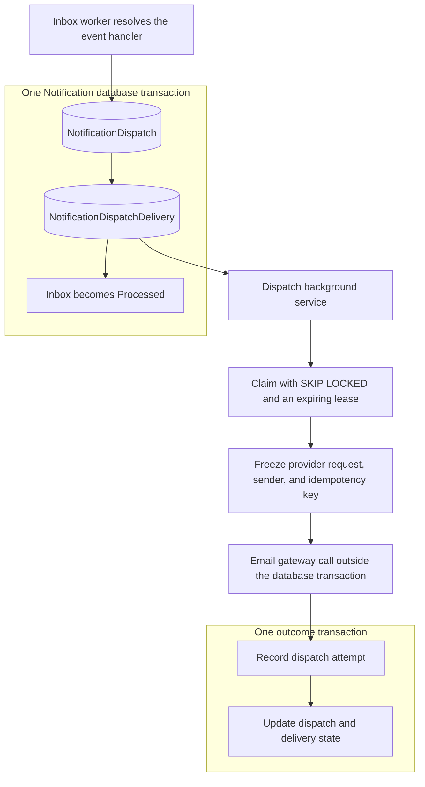
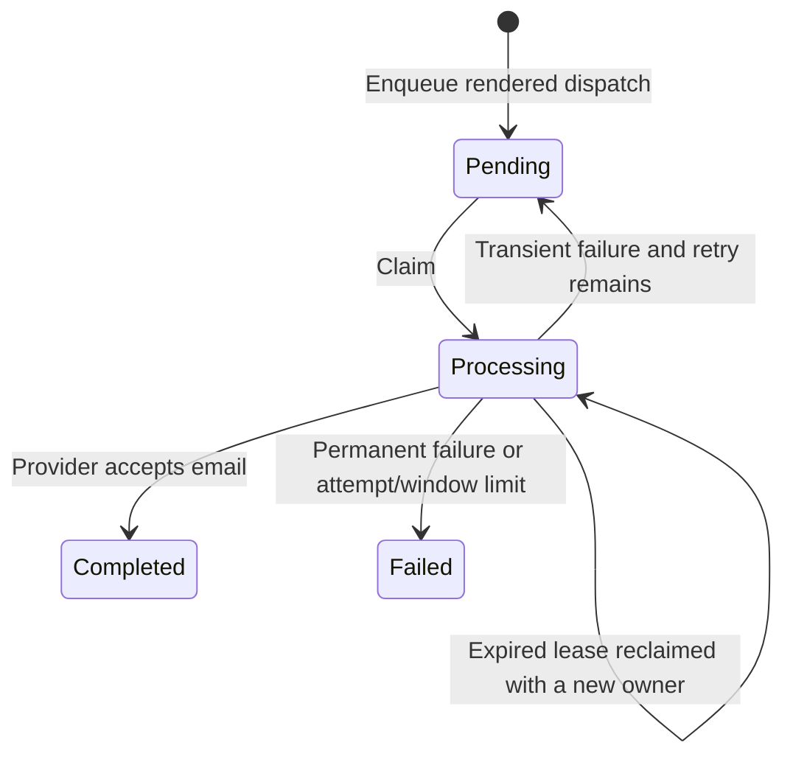

# Notification Dispatch Delivery

Phase 7 adds asynchronous email delivery for dispatches created by Inbox handlers.
The existing synchronous sender continues to own its own dispatches; the worker
only processes dispatches explicitly added to the durable delivery queue.

## Delivery pipeline



`NotificationDispatch` remains the business aggregate. Infrastructure owns the
one-to-one `NotificationDispatchDelivery` row and its lease, attempt budget,
prepared payload, retry scheduling, and operational state. These rows are created
alongside rendered dispatches in the Inbox processing transaction. Suppressed
dispatches do not enter the delivery queue.

## State and attempt history



During transient failures the dispatch stays `Pending`, and each persisted failure
adds a `NotificationAttempt`. A successful provider response changes the dispatch
to `Sent`; a terminal failure changes it to `Failed`. Each outcome and its delivery
queue transition commit together. `Sent` means the provider accepted the email;
existing provider webhooks continue to track delivery, opening, bounce, and other
later outcomes.

The queue's `AttemptCount` counts claims, including lease recovery after a crash.
The domain attempt history records outcomes that were successfully persisted. A
crash can therefore leave more claims than recorded domain attempts.

## Concurrency and recovery

- PostgreSQL `FOR UPDATE SKIP LOCKED` assigns disjoint batches to workers.
- Workers renew ownership before preparation and again before sending. A stale
  batch entry cannot renew an expired or stolen lease and does not call the provider.
- Final state transitions require the current `LockId`; a stale worker cannot
  overwrite the new owner's result or persist a stale dispatch attempt.
- Preparation, delivery, and outcome persistence use scoped services. Provider
  calls do not hold database transactions open.
- When outcome persistence fails, the delivery remains recoverable after lease
  expiry. The processor does not treat an uncertain commit as a new send failure.
- Application shutdown leaves the claim recoverable. A send timeout schedules a
  transient retry while the application is still running.

## Provider idempotency

Before the first network call, the worker persists the complete `EmailSendRequest`
and provider name. The payload includes sender/reply-to, recipient, subject, plain
text, HTML, and a stable key:

```text
notification-dispatch/{dispatchId}
```

Retries reuse that snapshot even if branding or email settings change. Resend
receives the key through its `Idempotency-Key` header. A provider change after
preparation is treated as a permanent failure rather than silently resending
through a different provider.

Resend retains idempotency keys for 24 hours and requires an unchanged request
payload. Automatic retries are bounded to 23 hours after preparation by default;
expired deliveries become failed and require operational review. This is an
at-least-once workflow with provider-assisted deduplication, not an unbounded
exactly-once guarantee. See [Resend's idempotency documentation](https://resend.com/blog/engineering-idempotency-keys).

## Error policy

| Failure | Behavior |
| --- | --- |
| Network failure or request timeout | Retry with the same payload/key |
| HTTP 408, 429, or 5xx | Transient retry |
| Resend concurrent idempotent request conflict | Transient retry |
| Resend payload/idempotency mismatch | Permanent failure |
| Other provider validation/authentication errors | Permanent failure |
| Invalid recipient, missing rendered content, corrupt saved request | Permanent failure |
| Invalid or incomplete provider success response | Idempotent retry to recover an uncertain outcome |
| Database failure after provider acceptance | Leave lease recoverable; reuse snapshot after recovery |
| Application shutdown | Leave current claim recoverable |

Retry delays use capped exponential backoff with jitter. A provider `Retry-After`
value takes precedence when it requests a longer wait, provided the resulting
attempt still fits within the safe delivery window. Exhausted attempts and
expired windows stop automatic retry.

## Configuration and rollout

Settings live under `Modules:Notification:DispatchProcessor`:

| Setting | Default |
| --- | --- |
| Enabled | `false` |
| BatchSize | `20` |
| PollingInterval | `00:00:05` |
| ClaimDuration | `00:02:00` |
| SendTimeout | `00:00:30` |
| MaximumAttempts | `10` |
| InitialRetryDelay | `00:00:05` |
| MaximumRetryDelay | `00:10:00` |
| RetryJitterFactor | `0.2` |
| MaximumDeliveryAge | `23:00:00` |

Startup validates these settings, including a claim duration longer than the send
timeout and a delivery window shorter than provider idempotency retention.

Migration `AddNotificationDispatchDelivery` creates the delivery table and claim
indexes without enqueuing existing synchronous dispatches. Apply the Notification
migration before enabling the worker. Phase 8 covers activation of the complete
host pipeline and migration of the remaining direct notification calls.

## Verification

The Notification test suites cover domain attempt history, concurrent claims,
locked-row skipping, lease renewal/recovery, stale ownership, immutable prepared
payloads, transient/permanent outcomes, retry timing, timeouts, shutdown, safe-window
expiry, outcome persistence rollback, legacy sender isolation, and the
Inbox-to-dispatch-to-gateway flow. Resend HTTP behavior is tested with a local
stub handler; no real emails are sent by these tests.
