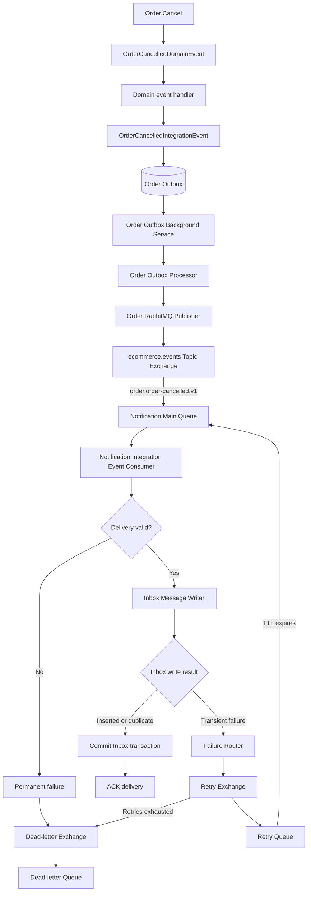
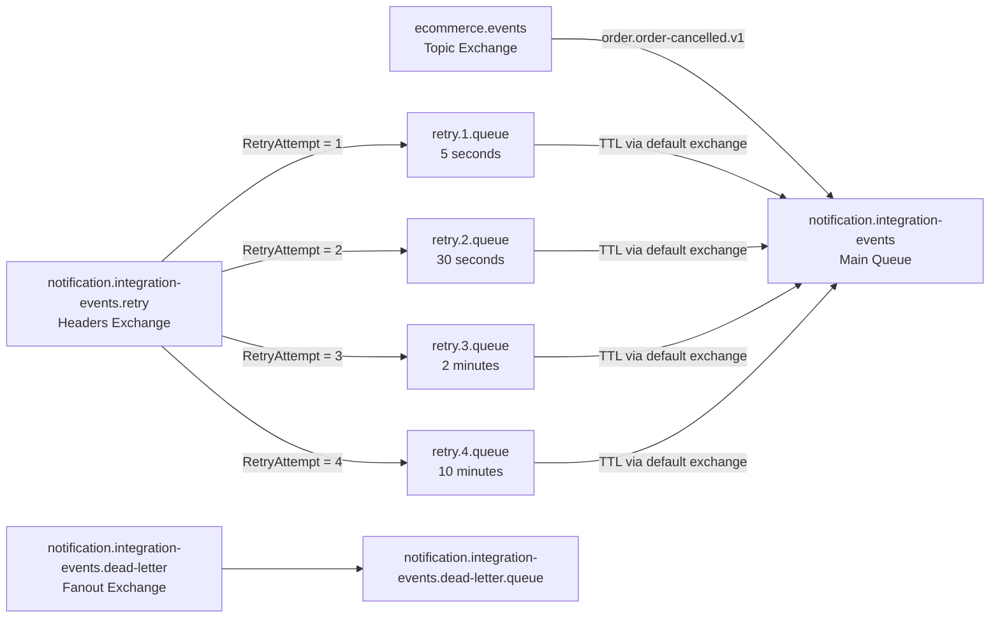
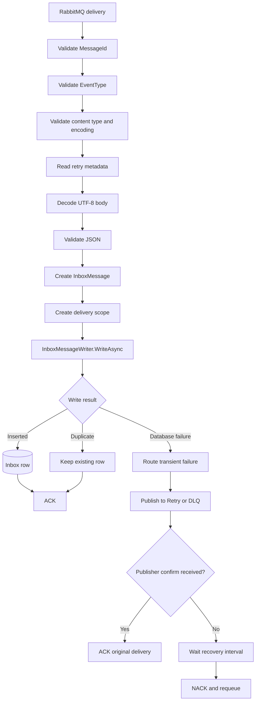
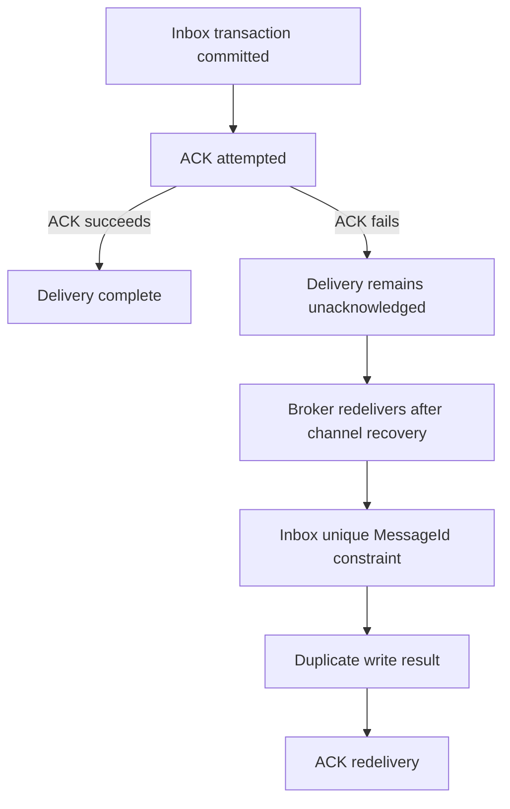
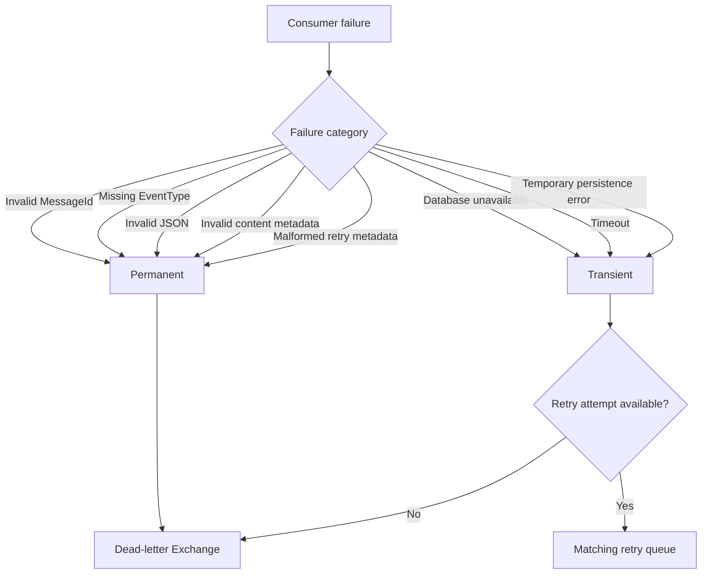
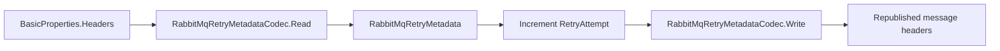
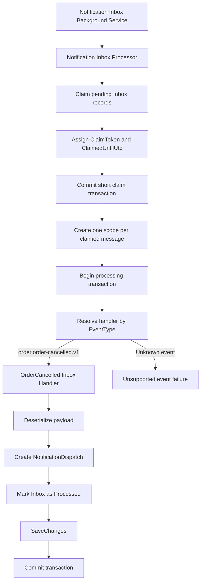
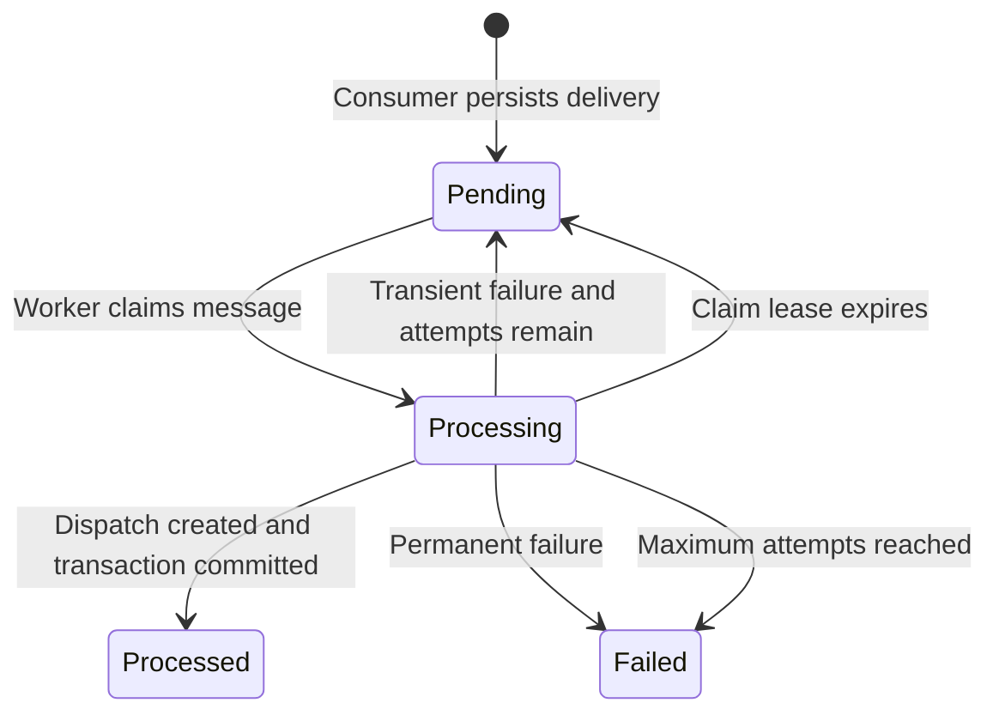
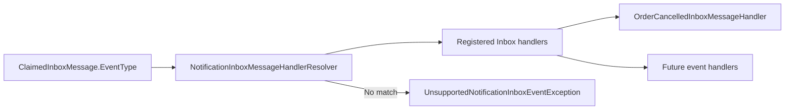
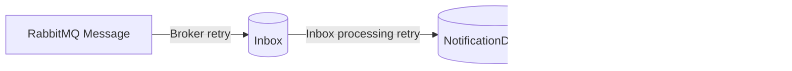

# Notification Messaging Architecture

This document describes the event-driven messaging pipeline currently implemented
between the `Order` and `Notification` modules. It covers transactional outbox
publishing, RabbitMQ delivery and retry topology, transactional Inbox persistence,
and asynchronous Inbox processing.

## End-to-End Flow



The consumer follows one critical ordering guarantee:

```text
Persist the message in the Inbox
    -> commit the database transaction
    -> acknowledge the RabbitMQ delivery
```

RabbitMQ never receives a successful acknowledgement before the message is durably
stored in the Notification database.

## RabbitMQ Topology



Expired retry messages return directly to the Notification main queue through
RabbitMQ's default exchange. They do not return to the global event exchange. This
prevents other modules that already handled the event from receiving the retry.

## Consumer Delivery Flow



Each delivery gets its own dependency-injection scope and `NotificationDbContext`.
This prevents concurrent deliveries from sharing a non-thread-safe EF Core context.

### ACK Failure After Inbox Commit



The unique Inbox `MessageId` provides idempotency when an ACK is lost after a
successful database commit.

## Broker Failure Classification



## Retry Metadata

The failure publisher preserves the original message properties and adds these
headers:

| Header | Purpose |
| --- | --- |
| `RetryAttempt` | Current RabbitMQ retry attempt |
| `OriginalExchange` | Exchange that received the original delivery |
| `OriginalRoutingKey` | Original integration-event routing key |
| `FirstFailedAtUnixTime` | UTC timestamp of the first failure |



Malformed or incomplete retry metadata is replaced with safe metadata before the
delivery is moved to the dead-letter queue. This prevents poison-message loops.

## Inbox Processing

The RabbitMQ consumer only validates and persists deliveries. Business processing
is performed separately by the Inbox background service.



Creating the `NotificationDispatch` and marking the Inbox record as `Processed`
happen in the same transaction. If either operation fails, both are rolled back.

## Inbox State Transitions



When transient processing fails, the processor calculates `NextAttemptAtUtc` using
exponential backoff with jitter. A new scope and DbContext persist the failure
result after the processing transaction has rolled back.

## Handler Resolution



Adding another integration event requires a new
`INotificationInboxMessageHandler` implementation and DI registration. The Inbox
processor does not need event-specific changes.

## Retry Boundaries

The architecture has separate retry mechanisms for separate reliability boundaries:

| Mechanism | Boundary | Handles |
| --- | --- | --- |
| RabbitMQ retry queues | Broker to Inbox | Failure to persist a delivery in the Inbox |
| Inbox database retry | Inbox to dispatch | Failure to transform an Inbox message into a dispatch |
| Dispatch retry (next phase) | Dispatch to provider | Failure to send through the email provider |



## Component Map

| Responsibility | Main component |
| --- | --- |
| Consume RabbitMQ deliveries | `NotificationIntegrationEventConsumer` |
| Declare queue, retry, and DLQ topology | `NotificationIntegrationEventTopology` |
| Select retry tier or DLQ | `NotificationIntegrationEventFailureRouter` |
| Publish failed deliveries with confirms | `RabbitMqFailureMessagePublisher<TPublisherIdentity>` |
| Encode and decode retry headers | `RabbitMqRetryMetadataCodec` |
| Persist idempotent Inbox rows | `InboxMessageWriter` |
| Claim and update Inbox records | `NotificationInboxStore` |
| Schedule Inbox processing | `NotificationInboxBackgroundService` |
| Orchestrate claimed messages | `NotificationInboxProcessor` |
| Resolve event-specific behavior | `NotificationInboxMessageHandlerResolver` |
| Handle order cancellation | `OrderCancelledInboxMessageHandler` |

## Current Boundary

The implemented pipeline currently ends after a `NotificationDispatch` is created:

```text
Domain Event
    -> Transactional Outbox
    -> RabbitMQ
    -> Broker retry / DLQ
    -> Transactional Inbox
    -> Claim-based Inbox processing
    -> Event-specific handler
    -> NotificationDispatch
```

The next phase will add claim-based `NotificationDispatch` delivery, email-provider
integration, retry scheduling, and terminal failure handling.
