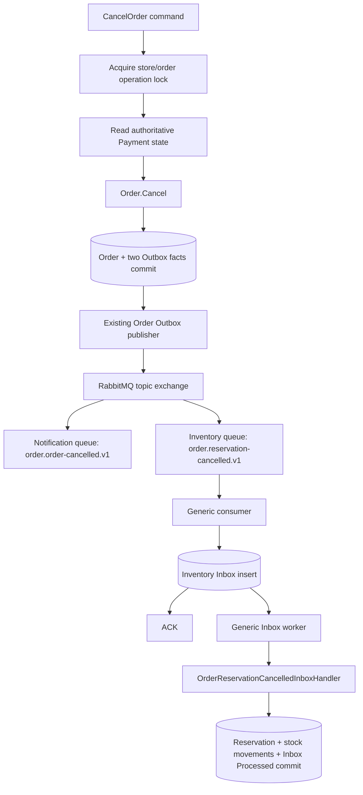

# Order cancellation to Inventory reservation release

Order cancellation now commits a separate `order.reservation-cancelled.v1` fact
instead of calling Inventory after saving Order. Inventory owns receipt, retries
and the local stock update. Its receiver uses the shared RabbitMQ consumer and
Inbox components introduced for Shipment-to-Order fulfillment.



## Source implementation

- `Order.Cancel` raises `OrderCancelledDomainEvent` for the existing customer
  notification and, when ReservationReference exists, an independent
  `OrderReservationCancelledDomainEvent` for Inventory.
- The two events have different message IDs and the same cancellation time.
  Retrying the domain cancellation on an already cancelled order emits neither again.
- `OrderDomainEventDispatcher` wraps the new domain event for MediatR.
  `OrderReservationCancelledDomainEventHandler` maps it to the public integration
  contract and stages it through the existing `IOrderOutboxWriter`.
- The contract contains message identity/time, StoreId, OrderId,
  ReservationReference and CancellationReason. It carries no customer contact data.
- Order and both Outbox rows share the existing local SaveChanges transaction.
  Rollback leaves no committed cancellation or outgoing messages.
- `CancelOrderCommandHandler` no longer synchronously releases Inventory.
  Failed-checkout compensation and Payment-to-Inventory confirmation retain their
  existing synchronous behavior.

## Payment/cancellation boundary

Cancelling from Order's payment-status copy alone is unsafe: a provider call or
Payment commit can precede synchronization back to Order.

`PostgreSqlOrderOperationLock` implements the public `IOrderOperationLock` contract.
CreatePayment, AuthorizePayment, CapturePayment and CancelOrder use the same
`(StoreId, OrderId)` advisory-lock key. Payment accesses it through its own
`IOrderPaymentOperationLock` adapter. These integrations reference public contracts,
not another module's DbContext or repository.

The lock is held through each command's existing provider/persistence/follow-up
sequence. It uses a dedicated nonpooled PostgreSQL session, not a transaction held
open across a provider call. Contention returns HTTP 409; closing the session or
losing the process releases ownership.

While owning the lock, cancellation reads `IPaymentModuleApi.GetByOrderIdAsync`.

| Authoritative Payment state | Cancellation |
| --- | --- |
| No Payment | Allowed, subject to Order domain rules |
| Pending, no provider attempt has started | Allowed |
| Pending after a provider attempt started | Reject: payment outcome is uncertain |
| RequiresAction / Authorized | Reject: resolve or cancel the payment first |
| Captured / PartiallyRefunded / Refunded | Reject |
| Failed / Cancelled | Allowed, subject to Order domain rules |
| Payment query fails | Propagate failure; do not cancel |

Authorize and Capture persist `Payment.HasProviderAttempt = true` **before** their
first provider call. If the process dies before a response or outcome commit, a
Pending row therefore cannot be mistaken for an untouched payment. Provider retry
must retain the stable idempotency key. A timeout does not automatically become a
Failed payment or permit cancellation.

The flag is exposed by Payment's public status result; its optional default is
conservative for older callers. The migration marks existing rows as attempted
because their historical provider uncertainty cannot be inferred from Pending.
Newly created payments start with the flag false.

Order's domain also rejects direct cancellation while its local payment state is
Authorized. The application entry point additionally performs the authoritative
guard and shared-lock checks. Future cancellation entry points must use that same
policy rather than bypassing the application flow.

This is a cancellation admission boundary, not a new Saga or a provider outcome
reconciliation engine. Provider contradictions, historical unknown outcomes and
the existing multi-module paid-order workflow still need their own explicit
reconciliation policy; broker retries do not settle those business decisions.

## Inventory implementation

- `InventoryDbContext` owns its own InboxMessages table and applies the shared EF
  configuration. It does not share Order or Notification's Inbox database.
- `AddModuleInbox<InventoryDbContext, InventoryReservationConsumerIdentity>` wires
  the scoped store/receiver and generic processor/background service.
- `AddRabbitMqConsumer<InventoryReservationConsumerIdentity>` binds only the new
  reservation event. Independent Notification and Inventory subscriptions each
  receive the fact they need.
- `OrderReservationCancelledInboxHandler` validates the envelope/payload identities,
  tenant, order and normalized reservation reference. It loads all affected
  InventoryItems through Inventory's repository.
- All matching reservations are validated before mutation. Wrong-order messages
  and Confirmed reservations become permanent Inbox failures. Missing reservations
  retry with a bounded budget; they are not silently treated as released.
- `InventoryItem.ReleaseReservation` already treats Released as idempotent. A new
  message ID for the same cancellation does not produce another movement.
- The generic Inbox processor commits all stock changes, reservation state changes,
  stock movements and Inbox Processed in one transaction.
- Inventory's existing Version concurrency token prevents competing confirmation
  and release operations from both committing stale state. A fresh retry cannot
  release a now Confirmed reservation.

## Transport failure behavior

Inbox insert completes before ACK. Ingress database failure uses the queue's
staged retry topology; TTL expiry routes directly back to Inventory's main queue.
Malformed envelopes go to its DLQ. Failure forwarding must be confirmed before
ACKing the original. Application processing failures use the durable Inbox retry
schedule, not another broker round trip.

The shared topology currently uses durable classic queues, matching the existing
pipeline. Broker-level at-least-once dead-letter guarantees require separately
configured and verified quorum queues; durable declarations alone do not provide
that guarantee across every broker failure.

## Cutover

1. Stop old writers before replacing the synchronous cancellation side effect.
2. Back up and apply Payment's `AddPaymentProviderAttemptFence` migration.
3. Apply Inventory's `AddInventoryCancellationInbox` migration.
4. Ensure the Inventory binding exists before publishing the new event; mandatory
   publishing only detects absence of every matching route, not every expected subscriber.
5. Enable Inventory's IntegrationEventConsumer and InboxProcessor and start the new version.

Development enables both workers. Production Compose exposes
`INVENTORY_CONSUMER_ENABLED` and `INVENTORY_INBOX_ENABLED`.

```powershell
dotnet ef database update --project src/Modules/Payment/Payment.Infrastructure --startup-project src/Host/ECommerce.API --context PaymentDbContext -- --environment Development
dotnet ef database update --project src/Modules/Inventory/Inventory.Infrastructure --startup-project src/Host/ECommerce.API --context InventoryDbContext -- --environment Development
```

The environment selects configuration; effective connection strings select databases.
Old cancelled orders are not blindly republished: existing reservations/payment
outcomes must be reviewed before historical reconciliation. The new event stream
does not reconstruct facts from before the cutover.

## Verification

`OrderInventoryCancellationTests` uses real PostgreSQL and RabbitMQ containers for
atomic producer persistence, rollback, independent notification routing, durable
receipt followed by consumer shutdown, multi-item release, transport and business
duplicates, tenant/order isolation, Confirmed protection, transaction failure/retry,
concurrent workers, release/confirmation conflicts and cross-instance operation locks.
It also checks the payment admission matrix, persisted uncertainty fence, conservative
legacy migration and payment-query failures.

`PaymentCancellationBoundaryTests` checks that a lost provider response preserves
uncertainty, a failed fence save prevents the provider call, and order-lock contention
stops authorization before persistence or provider work. Existing Order, Payment,
Inventory and messaging tests provide regression coverage.
