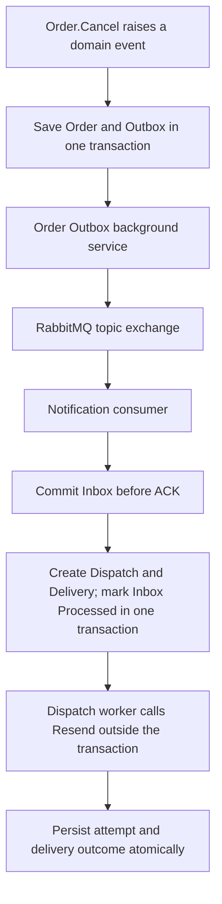

# Phase 8: Order Cancellation Messaging Verification

Phase 8 activates the first complete asynchronous notification flow in development.
It covers OrderCancelled; it does not migrate every notification trigger or activate
production workers automatically.

## Active flow



## Host and configuration

- `AddOrderModule` registers both Order infrastructure and Outbox processing.
- `AddNotificationModule` registers the consumer, Inbox worker, and Dispatch worker.
- Development enables all three Notification workers. Their option-class defaults
  remain disabled, and production must configure them explicitly.
- Apply Order and Notification migrations before starting the workers.
- The consumer must declare its queue and binding before the test event is published.
- Restart the API after changing worker flags: these services read `IOptions<T>`.
- API secrets remain in User Secrets or deployment secret configuration.

For local setup commands and RabbitMQ credentials, see the repository
[README](../README.md). Runtime delivery still depends on valid provider credentials
and a verified sender domain; enabling a worker does not verify these externally.

## Corrections found during activation

| Problem | Correction | Regression coverage |
| --- | --- | --- |
| Outbox registration existed but the Host never called it | Register Outbox processing from `AddOrderModule` | Host registration resolves the worker, scoped processor, and store |
| Cancellation still called the direct notification sender | Remove that call and its unused Order cancellation adapter method | Updated command-handler tests and existing domain/Outbox persistence tests |
| Binding appended retry delays to the initialized array | Replace the bound array with the explicitly configured delay array | Configured, absent, and descending-delay cases |
| Default template seeding used the global fallback ID, but tenant template creation rejected it | Add explicit `NotificationTemplate.CreateDefault`; retain tenant validation in `Create` | Domain validation and repeated database seeding tests |

Only the Order cancellation path changed. OrderPlaced, Payment, Shipment, and other
existing direct notification APIs remain in place. Legacy synchronous dispatches
are not automatically enqueued for the asynchronous sender.

## Live verification

Verified on October 26, 2026 against the local development PostgreSQL databases,
RabbitMQ broker, and actual Resend email API:

1. A temporary test harness created an unpaid test order using the existing domain
   factory and saved it through `OrderDbContext`.
2. `Order.Cancel` raised the real domain event; `SaveChangesAsync` dispatched it and
   committed the Order and Outbox message.
3. The production worker implementations published the message, persisted it in
   Inbox, created the Dispatch and Delivery, and invoked Resend.
4. Outbox became `Published`, Inbox became `Processed`, Dispatch became `Sent`, and
   Delivery became `Completed`. One Dispatch and one successful attempt were recorded.
5. The same event ID and payload were republished through RabbitMQ. The consumer
   reported `Duplicate`, acknowledged the message, and left one Dispatch and one
   attempt. No second email was created.
6. The recipient confirmed receipt of the cancellation email.

The live run also verified permanent rejection handling. The configured custom
sender domain was not verified, and Resend rejected it. Sending to an address
outside the account's permitted test recipient was also rejected. Both cases
produced terminal `Failed` dispatch/delivery states with a recorded failure.
Successful sending used a temporary `onboarding@resend.dev` sender override and the
account's permitted recipient. That override was not saved in application settings.

No payment was taken. The harness ran from the local temporary directory and is
not a deployed component. Test Orders, Outbox, Inbox, Dispatch, and Attempt records
were retained in development for inspection, including the rejected send cases.

### Scope of the evidence

This verifies domain-event creation through real email receipt and duplicate
delivery handling. It does not verify browser checkout, customer authentication,
the HTTP cancellation endpoint, production deployment, or provider webhook delivery.
`Sent` and `Completed` mean provider acceptance; recipient confirmation separately
established receipt for this smoke test.

The frozen-request policy still applies to failed test deliveries: changing sender
configuration does not change their persisted provider request. A new verification
case uses a new test order rather than editing a terminal record or its snapshot.

## Repeatable automated checks

The automated suites use isolated test infrastructure or provider stubs; they do
not send real email. Docker must be available for container-backed integration tests.

The closure run on October 26, 2026 passed 114 tests across the nine suites below.
The full solution built with zero errors; existing dependency and analyzer warnings
remain. This was a targeted messaging regression run, not a claim that every test
in the repository passed.

```powershell
dotnet build ECommerce.slnx --no-restore -m:1

dotnet test src/Modules/Order/tests/Order.Application.UnitTests/Order.Application.UnitTests.csproj --no-build --no-restore
dotnet test src/Modules/Order/tests/Order.Domain.UnitTests/Order.Domain.UnitTests.csproj --no-build --no-restore
dotnet test src/Modules/Order/tests/Order.Infrastructure.UnitTests/Order.Infrastructure.UnitTests.csproj --no-build --no-restore
dotnet test src/Modules/Order/tests/Order.Infrastructure.IntegrationTests/Order.Infrastructure.IntegrationTests.csproj --no-build --no-restore
dotnet test src/Modules/Notification/tests/Notification.Domain.UnitTests/Notification.Domain.UnitTests.csproj --no-build --no-restore
dotnet test src/Modules/Notification/tests/Notification.Application.UnitTests/Notification.Application.UnitTests.csproj --no-build --no-restore
dotnet test src/Modules/Notification/tests/Notification.Infrastructure.IntegrationTests/Notification.Infrastructure.IntegrationTests.csproj --no-build --no-restore
dotnet test src/BuildingBlocks/tests/BuildingBlocks.Messaging.RabbitMQ.IntegrationTests/BuildingBlocks.Messaging.RabbitMQ.IntegrationTests.csproj --no-build --no-restore
dotnet test Host/ECommerce.API.UnitTests/ECommerce.API.UnitTests.csproj --filter FullyQualifiedName~OrderModuleRegistrationTests --no-build --no-restore
```

Coverage includes transactional Outbox persistence, broker confirms and returns,
consumer ACK timing, duplicate Inbox writes, claims and lease recovery, rollback,
provider request snapshots, bounded retries, default seeding, and Host registration.

## Remaining work

- Verify the deployment sender domain before normal delivery to arbitrary recipients.
- Configure and validate production activation separately.
- Phase 9 adds operational visibility, health checks, safe replay, retention, and
  broader failure/restart exercises.
- Roll out the validated pattern to other notification triggers and modules gradually.
