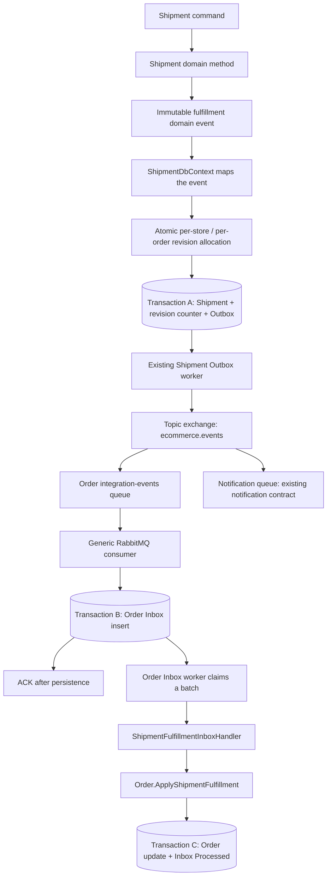
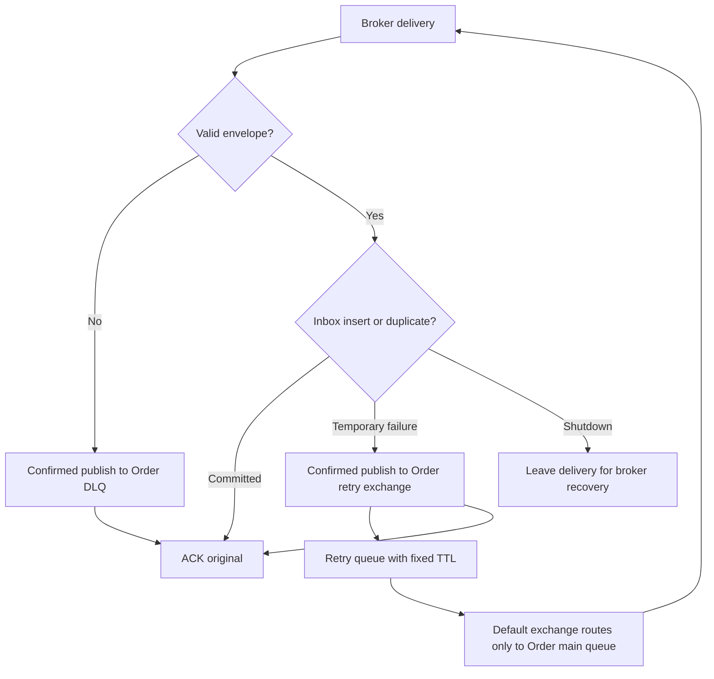

# Shipment to Order fulfillment messaging

This case replaces Shipment's synchronous writes into Order with a durable,
asynchronous projection. Shipment owns fulfillment facts. Order keeps the latest
fulfillment snapshot for its own queries and business rules.

## The complete path



There is no transaction shared between module databases and no broker publish
inside a business transaction. The Outbox and Inbox bridge those separate commits.
The Shipment command can succeed while Order is temporarily unavailable. Order
catches up when its consumer and worker resume.

## Read the implementation in this order

Paths below are relative to `src/`.

| Order | File or component | Responsibility |
| --- | --- | --- |
| 1 | `Modules/Shipment/Shipment.Domain/Entities/Shipment.cs` | Protect state transitions and raise facts |
| 2 | `Modules/Shipment/Shipment.Domain/Events/ShipmentFulfillmentChangedDomainEvent.cs` | Capture immutable state at the transition |
| 3 | `Modules/Shipment/Shipment.Contracts/IntegrationEvents/ShipmentFulfillmentChangedIntegrationEvent.cs` | Public, versioned message contract |
| 4 | `Modules/Shipment/Shipment.Infrastructure/Persistence/ShipmentDbContext.cs` | Map domain facts and coordinate the source transaction |
| 5 | `Modules/Shipment/Shipment.Infrastructure/Persistence/Fulfillment/ShipmentFulfillmentRevisionAllocator.cs` | Allocate the next order-wide revision atomically |
| 6 | `BuildingBlocks/BuildingBlocks.Infrastructure/Messaging/Outbox/DomainEventOutboxDbContext.cs` | Gather events and stage serialized Outbox messages |
| 7 | `BuildingBlocks/BuildingBlocks.Infrastructure/Messaging/Outbox/ModuleOutboxProcessor.cs` | Claim, publish, retry and finalize persisted messages |
| 8 | `BuildingBlocks/BuildingBlocks.Messaging.RabbitMQ/Publishing/RabbitMqIntegrationEventPublisher.cs` | Publish with confirms and mandatory routing |
| 9 | `BuildingBlocks/BuildingBlocks.Messaging.RabbitMQ/Consuming/RabbitMqConsumerTopology.cs` | Declare bindings, retry queues and DLQ |
| 10 | `BuildingBlocks/BuildingBlocks.Messaging.RabbitMQ/Consuming/RabbitMqIntegrationEventConsumer.cs` | Receive, validate, persist through a scoped receiver, then ACK |
| 11 | `BuildingBlocks/BuildingBlocks.Infrastructure/Messaging/Inbox/ModuleInboxReceiver.cs` and `ModuleInboxStore.cs` | Deduplicate and persist messages in the receiving database |
| 12 | `BuildingBlocks/BuildingBlocks.Infrastructure/Messaging/Inbox/ModuleInboxBackgroundService.cs` | Schedule the processing loop |
| 13 | `BuildingBlocks/BuildingBlocks.Infrastructure/Messaging/Inbox/ModuleInboxProcessor.cs` | Claim work, resolve handlers and own the processing transaction |
| 14 | `Modules/Order/Order.Infrastructure/Messaging/Shipment/ShipmentFulfillmentInboxHandler.cs` | Deserialize the contract and locate the tenant's order |
| 15 | `Modules/Order/Order.Domain/Entities/Order.cs` | Apply a newer snapshot while preserving business invariants |
| 16 | `Modules/Order/Order.Infrastructure/DependencyInjection/OrderInfrastructureServiceCollectionExtensions.cs` | Wire the consumer, Inbox and handler together |

## Why a separate integration event?

The existing `shipment.status-changed.v1` contract carries notification-specific
outcomes and recipient information. Order requires creation, readiness,
cancellation and delivery state with an order-wide revision. Those are different
consumer requirements. The new contract is `shipment.fulfillment-changed.v1`.

Both facts use the same module-owned Outbox and publisher. They have distinct
message IDs, so Outbox deduplication cannot discard one of them. Notification
keeps its existing subscription; it is not bound to the new fulfillment event.

The domain event captures the status when it occurs. Mapping must not read the
aggregate's final status for all events: several transitions may happen before
one save. Draft, Ready, Shipped and Delivered must remain four distinct snapshots.

## Three identities and concurrency controls

| Value | Scope | Problem it solves |
| --- | --- | --- |
| Message ID | One event, preserved through Outbox, RabbitMQ and Inbox | Duplicate delivery of the same message |
| FulfillmentRevision | `(StoreId, OrderId)` across all shipments | Older snapshots arriving after newer snapshots |
| PostgreSQL `xmin` | One persisted Shipment or Order row | Concurrent writers overwriting each other's changes |

The same shipment row is updated through its lifecycle. Cancelling A and creating
replacement B creates a second shipment row. `ShipmentFulfillmentSequences`
contains **one counter row per store/order**, not one row per status change.

Example:

| Fact | Shipment row | Order-wide revision |
| --- | --- | --- |
| A created | A | 1 |
| A cancelled | A | 2 |
| B created | B | 3 |
| B shipped | B | 4 |

If revision 4 arrives before revision 2, Order applies 4 and records 2 as processed
without changing its state. A per-shipment counter would restart for B and could
make the newer shipment appear older than A.

The counter stores only its latest number. Each emitted Outbox payload preserves
its own revision. This is not an event-sourcing or permanent audit-history store;
deleting processed messages also deletes that message history.

The allocator uses PostgreSQL `INSERT ... ON CONFLICT DO UPDATE ... RETURNING`
inside the same transaction as Shipment and Outbox. A failed save rolls back the
counter increment and removes newly staged messages from the change tracker.
Retrying the save allocates again. A unique filtered index also prevents two
non-cancelled shipments for the same store/order.

## Order projection rules

| Shipment snapshot | Order fulfillment | Shipment reference |
| --- | --- | --- |
| Draft / ReadyForDispatch | Unfulfilled | Set |
| Shipped / DeliveryException | Shipped | Set |
| Delivered | Delivered | Set |
| Cancelled | Unfulfilled | Cleared |

Cancellation retains the last shipment ID and revision as a tombstone. An older
creation event therefore cannot restore its reference. A replacement may take
over an unfulfilled order, even if the intermediate cancellation has not arrived.
Delivered and shipped states cannot regress to unfulfilled. Fulfillment updates
do not cancel or complete the order and do not alter its payment state.

Each worker message gets its own DI scope, DbContext and local transaction. Two
workers can claim different messages for the same order. `xmin` makes the stale
save fail; the processor rolls back and retries in a fresh scope. On retry, the
handler sees the committed revision and either applies or skips the snapshot.

The worker renews ownership inside its transaction before invoking the handler.
That update locks the Inbox row until commit, so another worker using `SKIP LOCKED`
cannot reclaim it while the local database work is in progress. Keep these
handlers limited to local database work; do not add email or HTTP calls here.

## ACK, retries and failure boundaries



- Broker ingress: malformed messages go to the DLQ. Database ingress failures use
  the existing staged retry-header convention. Exhausted retries go to the DLQ.
- Retry publication: the original is ACKed only after the copy is confirmed. A
  publication error delays and requeues the original. ACK failure triggers channel
  replacement; it never sends an already persisted message into business retry.
- Retry TTL expiry: `x-dead-letter-exchange = ""` and
  `x-dead-letter-routing-key = mainQueueName` return the message only to Order.
  The original routing key is recovered from retry metadata when storing the Inbox.
- Inbox processing: malformed or contradictory business payloads become Failed.
  Temporary database/concurrency failures return to Pending with capped exponential
  backoff and jitter. Attempt budgets and expired-claim recovery are separate from
  the broker-ingress retry budget.
- Delivery remains at least once at the application boundaries. Publisher-confirm
  ambiguity and failed ACKs can produce duplicates. Inbox and revision checks make
  the local projection idempotent; this is not a claim of exactly-once transport.

This uses the repository's existing durable classic-queue retry approach. Classic
queue dead-letter forwarding has broker-level loss windows during failures; a
cluster deployment needing stronger dead-letter guarantees must configure and
verify quorum queues with at-least-once dead-lettering. Queue durability alone is
not a substitute for that broker configuration.

## What stays synchronous?

Shipment still reads Order's public context to validate order existence, tenant
ownership and captured payment before creation. Payment-to-Order coordination,
Payment-to-Shipment creation, inventory operations, price reads and gateway calls
keep their current behavior.

Active shipment existence is checked in Shipment's own database, backed by its
unique index. Order's lagging reference/fulfillment projection is no longer used
to decide whether a replacement shipment can be created.

The old `IOrderShipmentSyncService`, its adapter, the four shipment-write methods
on `IOrderModuleApi`, and their request DTO have been removed. There is one
revision-aware domain entry point for applying shipment fulfillment.

## Add another event using this infrastructure

1. Decide whether eventual consistency is valid. Keep commands that require an
   immediate remote decision synchronous unless their business workflow is redesigned.
2. Put the immutable domain fact in the producing Domain layer; raise it from the
   aggregate after its invariants pass. Keep RabbitMQ, JSON and EF out of Domain.
3. Put the public integration contract in the producer's Contracts project. Give
   it a stable, versioned EventType and the minimum data its consumers need.
4. Map the domain fact in the producer's staging hook and call
   `StageIntegrationEvent(storeId, integrationEvent)`. Preserve event ID and time.
   Existing Outbox workers require no event-specific publish code.
5. Give a new consuming module a consumer identity and its **own database Inbox**.
   Apply `InboxMessageConfiguration` and create a migration. Never point one
   module's receiver at another module's Inbox.
6. Implement `IModuleInboxMessageHandler<TIdentity>`. Expose the contract's EventType,
   deserialize/validate payload identity and tenant, and change only local state.
   Let the processor own SaveChanges and commit. More event types for the same
   subscriber can use more handlers with the same identity and queue.
7. Register the module and its handlers, for example:

   ```csharp
   services.AddModuleInbox<ConsumerDbContext, ConsumerIdentity>(
       configuration, "Modules:Consumer:InboxProcessor");
   services.AddScoped<IModuleInboxMessageHandler<ConsumerIdentity>, SpecificHandler>();
   services.AddRabbitMqConsumer<ConsumerIdentity>(
       configuration, "Modules:Consumer:IntegrationEventConsumer",
       FirstIntegrationEvent.EventType, SecondIntegrationEvent.EventType);
   ```

   The host registers `AddRabbitMqMessaging(configuration)` once. That supplies
   shared role-specific connections and typed publisher/failure-publisher services.
   Each typed publisher and consumer owns its channel.

8. Bind every required EventType. A handler registration does not subscribe a queue;
   a binding alone does not implement business processing. Both registrations matter.
9. Add business idempotency and ordering rules when required. Message-ID dedup does
   not order different messages. A revision for a latest-state projection is not
   suitable for workflows that must execute every intermediate action.
10. Add configuration, migrations and a deployment/backfill plan. Test duplicates,
    rollback, old snapshots, concurrent writes, tenant isolation, retry/DLQ and recovery.

## Deployment and configuration

Stop old writers/workers before this cutover so synchronous and asynchronous
writers cannot run together. Back up the databases. Apply the Order migration
first, then Shipment's `AddShipmentFulfillmentRevisions` migration. The latter
seeds one current snapshot and revision counter per existing store/order.

The unique active-shipment index intentionally rejects pre-existing duplicate
active shipments. Reconcile such data explicitly; the migration never chooses
and deletes a business record to make the index succeed.

```powershell
dotnet ef database update --project src/Modules/Order/Order.Infrastructure --startup-project src/Host/ECommerce.API --context OrderDbContext -- --environment Development
dotnet ef database update --project src/Modules/Shipment/Shipment.Infrastructure --startup-project src/Host/ECommerce.API --context ShipmentDbContext -- --environment Development
```

`--environment Development` selects configuration; it does not create a separate
database automatically. The effective connection strings determine the targets.

Start the new application with both Order `IntegrationEventConsumer.Enabled` and
`InboxProcessor.Enabled` enabled. The checked-in development overrides enable
both; production Compose exposes `ORDER_CONSUMER_ENABLED` and `ORDER_INBOX_ENABLED`.
Shipment's existing Outbox worker remains the publisher. Undeliverable messages
stay retryable in Outbox until the new durable binding exists.

Do not use a schema downgrade as a replay strategy after messages have been
processed. Deployment rollback requires coordinating writers and retained messages.

## Verification

`ShipmentOrderFulfillmentTests` runs on real PostgreSQL and RabbitMQ containers.
It covers immutable snapshots, source transaction rollback, failed-save retry,
replacement revisions, source concurrency, migration backfill, duplicate/stale
delivery, processing rollback, tenant isolation, competing workers, Order row
concurrency, broker ingress retry isolation and malformed-message dead lettering.

`ShipmentFulfillmentTests` exercises projection invariants in Domain. Existing
Shipment command tests cover persistence and stale Order projections. Host
registration tests validate the real DI wiring and retry-delay configuration.
